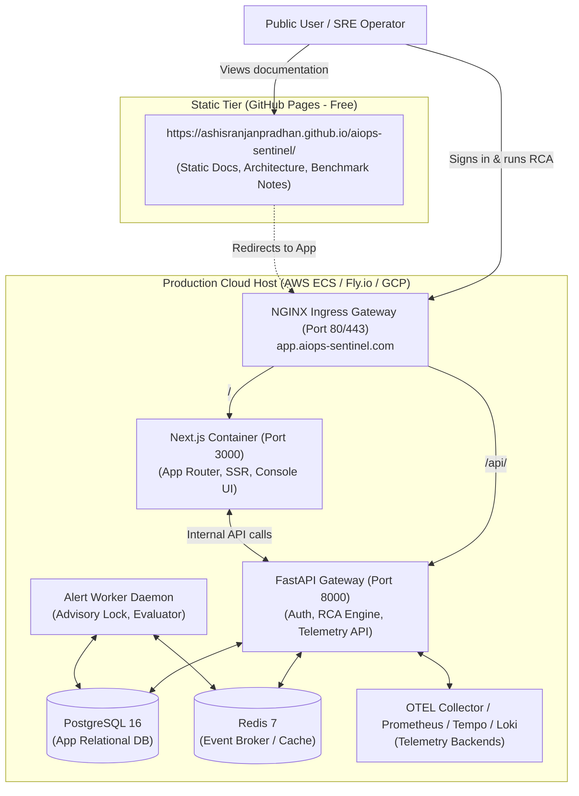

# AIOps Sentinel — Deployment Gap Analysis

**Author:** Release QA Architect & DevOps Auditor  
**Date:** November 24, 2026  
**Repository:** [https://github.com/Ashisranjanpradhan/aiops-sentinel](https://github.com/Ashisranjanpradhan/aiops-sentinel)  
**Static GitHub Pages URL:** [https://ashisranjanpradhan.github.io/aiops-sentinel/](https://ashisranjanpradhan.github.io/aiops-sentinel/)  

---

## 1. Executive Answer to the Primary Question

> **"Why can the user see the public AIOps Sentinel documentation website but cannot locate the login page and RCA application?"**

### Direct Root Cause
1. **GitHub Pages is exclusively deploying the `./gh-pages` directory:**
   The GitHub Actions workflow `.github/workflows/pages.yml` specifies:
   ```yaml
   - name: Upload Pages Artifact
     uses: actions/upload-pages-artifact@v3
     with:
       path: './gh-pages'
   ```
   The directory `gh-pages/` contains **only standalone static HTML/CSS/JavaScript marketing and documentation pages** (`index.html`, `about.html`, `features.html`, `research.html`, `architecture.html`, `docs.html`, `contact.html`, `404.html`, `styles.css`, and `main.js`). It does **not** contain the Next.js frontend application, nor does it contain a login page or an RCA console.

2. **The full dynamic application (Next.js + FastAPI + PostgreSQL + Redis) has NOT been deployed to any public cloud host:**
   The staging and production deployment workflow `.github/workflows/deploy.yml` contains stubbed-out shell commands:
   ```yaml
   - name: Trigger Staging Container Pull & Rolling Update
     run: |
       echo "Executing zero-downtime rolling update on staging..."
       echo "docker compose -f docker-compose.staging.yml pull"
       echo "docker compose -f docker-compose.staging.yml up -d --remove-orphans"
   ```
   The repository has verified Docker images and passing CI tests, but **no cloud server (e.g. AWS ECS, Fly.io, DigitalOcean, or GCP Cloud Run) has been configured or provisioned to run the live containers**.

3. **Fundamental Architectural Boundary:**
   GitHub Pages is a static file object host. It cannot execute Python, run FastAPI, host PostgreSQL, broker Redis queues, or execute background observability workers. The full authenticated AIOps Sentinel application requires a containerized runtime environment.

---

## 2. Directory & Component Disconnect Matrix

| Component | Repository Location | Built by CI? | Deployed to GitHub Pages? | Deployed to Cloud Host? | Current Accessibility |
| :--- | :--- | :---: | :---: | :---: | :--- |
| **Static Documentation Website** | `gh-pages/` | N/A (Static files) | **YES** | N/A | **Publicly accessible** at `https://ashisranjanpradhan.github.io/aiops-sentinel/` |
| **Dynamic Next.js Frontend** | `frontend/` | **YES** (`next build`) | **NO** | **NO** | Accessible **only locally** at `http://localhost:3000` |
| **Login & Registration Page** | `frontend/src/app/(auth)/login/` | **YES** | **NO** | **NO** | Accessible **only locally** at `http://localhost:3000/login` |
| **Overview & SRE Dashboard** | `frontend/src/app/(app)/overview/` | **YES** | **NO** | **NO** | Accessible **only locally** at `http://localhost:3000/overview` |
| **RCA & Incident Investigation** | `frontend/src/app/(app)/incidents/` | **YES** | **NO** | **NO** | Accessible **only locally** at `http://localhost:3000/incidents/[id]` |
| **Microservice Topology Graph** | `frontend/src/app/(app)/topology/` | **YES** | **NO** | **NO** | Accessible **only locally** at `http://localhost:3000/topology` |
| **Codebase Assessment Engine** | `frontend/src/app/(app)/codebase-assessments/` | **YES** | **NO** | **NO** | Accessible **only locally** at `http://localhost:3000/codebase-assessments` |
| **FastAPI Backend API Gateway** | `backend/app/` | **YES** (`pytest`, Docker) | **NO** | **NO** | Accessible **only locally** at `http://localhost:8000` |
| **Telemetry Ingestion (OTEL/Prom)** | `backend/app/integrations/` | **YES** | **NO** | **NO** | Accessible **only locally** in demo simulation |
| **PostgreSQL Database** | `compose.yaml` | **YES** (Migrations tested) | **NO** | **NO** | Local SQLite fallback / Docker Compose |
| **Background Alert Worker** | `backend/app/services/alert_worker.py` | **YES** | **NO** | **NO** | Local process / Docker Compose |

---

## 3. GitHub Actions Publishing Workflow Dissection

### 3.1 `.github/workflows/pages.yml` (Authoritative Pages Publisher)
- **Trigger:** Push to `main` modifying `gh-pages/**` or `.github/workflows/pages.yml`.
- **Target Environment:** `github-pages`
- **Artifact Path:** `./gh-pages`
- **Output:** Deploys raw static HTML files directly to GitHub Pages CDN.
- **Limitation:** Only 14 files/assets exist in `./gh-pages`. Zero JavaScript application logic from `frontend/` is bundled or uploaded to Pages.

### 3.2 `.github/workflows/deploy.yml` (Stubbed Deployment Pipeline)
- **Trigger:** Push to `main` or release tags (`v*.*.*`).
- **Target Environments:** `staging` and `production`
- **Implementation State:** **MOCK / SIMULATION ONLY**.
  Lines 39-45:
  ```bash
  test -n "${{ secrets.STAGING_HOST }}" || echo "Notice: STAGING_HOST secret pending configuration."
  echo "Executing zero-downtime rolling update on staging..."
  echo "docker compose -f docker-compose.staging.yml pull"
  echo "docker compose -f docker-compose.staging.yml up -d --remove-orphans"
  ```
  The workflow prints bash commands to stdout but does not execute SSH connections, does not authenticate with remote servers, and does not pull or run containers.

---

## 4. Technical Impediments to Hosting Full Next.js on GitHub Pages

If an attempt were made to force GitHub Pages to host the Next.js application, the following fundamental blockers occur:

1. **Standalone Output Mode (`output: 'standalone'`):**
   `frontend/next.config.js` is configured for Node.js server deployment:
   ```javascript
   const nextConfig = {
     reactStrictMode: true,
     output: 'standalone',
     async rewrites() {
       return [
         {
           source: '/api/v1/:path*',
           destination: process.env.NEXT_PUBLIC_API_BASE_URL 
             ? `${process.env.NEXT_PUBLIC_API_BASE_URL}/api/v1/:path*`
             : 'http://localhost:8000/api/v1/:path*',
         },
       ];
     },
   };
   ```
   Static export (`output: 'export'`) is disabled because the application uses dynamic server-side rewrites to route `/api/v1` traffic to the FastAPI backend.

2. **Dynamic Server-Rendered Routes (`λ` in Next.js build):**
   The Next.js build generates 4 dynamic server routes:
   - `/incidents/[incidentId]` (Incident detail & RCA candidates)
   - `/services/[serviceId]` (Service deep dive & telemetry metrics)
   - `/codebase-assessments/[assessmentId]` (Assessment scorecards)
   - `/experiments/[runId]` (ML experiment artifacts)
   
   GitHub Pages cannot route dynamic path parameters (`/incidents/inc_123`) without server-side rewrite rules or full static parameter pre-rendering (`generateStaticParams`). Visitors navigating to these deep links on GitHub Pages receive `HTTP 404 Not Found`.

3. **Backend Service Decoupling:**
   Even if the frontend static shell were hosted on Pages, all write actions (`/auth/login`, `/incidents/[id]/investigations`, `/assessments/upload`) fail immediately unless an authenticated, HTTPS-enabled backend API is running at a publicly accessible domain with CORS headers permitting the GitHub Pages origin (`https://ashisranjanpradhan.github.io`).

---

## 5. Required Deployment Target Architecture

To transition the authenticated AIOps Sentinel platform from a local-only prototype to a live, publicly accessible system, the following cloud topology is required:



### Necessary Steps for Live Public Application Release:
1. Provision a VM or container cluster (e.g., Fly.io, Railway, DigitalOcean App Platform, AWS ECS).
2. Configure environment variables in GitHub Repository Secrets (`PROD_HOST`, `SESSION_SECRET`, `DATABASE_URL`, `REDIS_URL`).
3. Implement real deployment SSH or webhook automation in `.github/workflows/deploy.yml`.
4. Point DNS domain (e.g., `app.aiops-sentinel.com`) to the ingress IP.
5. In `gh-pages/index.html` and header navigation, link the "Launch Console" button to `https://app.aiops-sentinel.com/login`.
