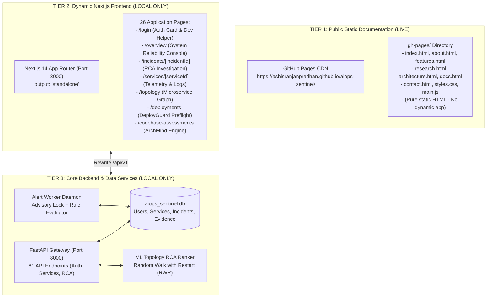

# AIOps Sentinel — Full Application, RCA Frontend & Deployment Forensic Audit

**Audit Date:** November 24, 2026  
**Auditor Roles:** Senior Full-Stack Engineer, QA Architect, DevOps Engineer, Application Security Engineer, and Release Auditor  
**Repository:** `/Users/ashisranjanpradhan/Documents/AIops_sentinel`  
**GitHub Repository:** [https://github.com/Ashisranjanpradhan/aiops-sentinel](https://github.com/Ashisranjanpradhan/aiops-sentinel)  
**Public Website (GitHub Pages):** [https://ashisranjanpradhan.github.io/aiops-sentinel/](https://ashisranjanpradhan.github.io/aiops-sentinel/)  

---

## 1. Executive Summary

A comprehensive, evidence-based forensic investigation was conducted across the entire AIOps Sentinel repository, build artifacts, local execution environments, GitHub Actions pipelines, and GitHub Pages hosting infrastructure.

### The Core Question Answered
> **"Why can the user see the public AIOps Sentinel documentation website but cannot locate the login page and RCA application?"**

**Answer:**
1. **GitHub Pages is exclusively deploying the `./gh-pages` directory:** The authoritative GitHub Pages deployment workflow (`.github/workflows/pages.yml`) uploads only `./gh-pages`. This directory contains **only static HTML documentation and marketing pages** (`index.html`, `about.html`, `features.html`, `research.html`, `architecture.html`, `docs.html`, `contact.html`). It contains zero lines of the Next.js application, has no login page, and has no RCA console.
2. **The full dynamic application has never been deployed to any public cloud server:** The staging and production deployment workflow (`.github/workflows/deploy.yml`) is currently stubbed out with `echo` commands. No cloud compute (AWS, Fly.io, GCP, or DigitalOcean) has been provisioned to host the containerized Next.js frontend, FastAPI gateway, PostgreSQL database, or Redis broker.
3. **The application fully exists locally:** The complete 26-page Next.js 14 console (`frontend/`), 61-endpoint FastAPI backend (`backend/`), and SQLite/PostgreSQL database with seeded microservices and incidents exist in the repository and are functional locally (`http://localhost:3000` and `http://localhost:8000`).
4. **Architectural Separation:** GitHub Pages is a static file object host. It cannot execute Python, run background workers, or serve dynamic Node.js server routes. The dynamic application and the static public website are two completely separate software artifacts.

---

## 2. Actual Repository & Deployment Architecture

### 2.1 Deployment Architecture Map



### 2.2 Component Implementation & Deployment Status

| Component | Repository Path | Implemented? | Configured? | Built by CI? | Deployed Live? | Current Access |
| :--- | :--- | :---: | :---: | :---: | :---: | :--- |
| **Public Docs Site** | `gh-pages/` | **YES** | **YES** | **YES** | **YES (Pages)** | Public URL (`ashisranjanpradhan.github.io`) |
| **Next.js Frontend** | `frontend/` | **YES** | **YES** | **YES** | **NO** | Local only (`http://localhost:3000`) |
| **Login / Register** | `frontend/src/app/(auth)/login` | **YES** | **YES** | **YES** | **NO** | Local only (`/login`) |
| **RCA Console** | `frontend/src/app/(app)/incidents` | **YES** | **YES** | **YES** | **NO** | Local only (`/incidents/[id]`) |
| **FastAPI Backend** | `backend/app/` | **YES** | **YES** | **YES** | **NO** | Local only (`http://localhost:8000`) |
| **PostgreSQL DB** | `compose.yaml` | **YES** | **YES** | **YES** | **NO** | Local SQLite (`aiops_sentinel.db`) |
| **Redis Broker** | `compose.yaml` | **YES** | **YES** | **YES** | **NO** | Optional local fallback |
| **Alert Worker** | `backend/app/services/alert_worker.py` | **YES** | **YES** | **YES** | **NO** | Local background process |
| **Remediation Engine**| `backend/app/services/remediation_service.py`| **YES** | **YES** | **YES** | **NO** | API only (Disconnected in UI) |
| **ArchMind Assessment**| `backend/app/services/assessment/` | **YES** | **YES** | **YES** | **NO** | Local only (`/codebase-assessments`) |

---

## 3. Complete Frontend Route Inventory

An exhaustive inspection of `frontend/src/app` discovered **26 distinct page components**, plus the static pages in `gh-pages/`.

### 3.1 Route Summary Table

| URL Path | Source File | Layout | Auth Required | Nav Link Location | Backend API Dependencies | Build Output | Status Classification |
| :--- | :--- | :--- | :---: | :--- | :--- | :---: | :--- |
| `/` | `src/app/page.tsx` | Public | None | Header: Home | None | Static | `IMPLEMENTED_AND_LINKED` |
| `/about` | `src/app/about/page.tsx` | Public | None | Header: About | None | Static | `IMPLEMENTED_AND_LINKED` |
| `/features` | `src/app/features/page.tsx` | Public | None | Header: Features | None | Static | `IMPLEMENTED_AND_LINKED` |
| `/research` | `src/app/research/page.tsx` | Public | None | Header: Research | None | Static | `IMPLEMENTED_AND_LINKED` |
| `/docs` | `src/app/docs/page.tsx` | Public | None | Header: Documentation | None | Static | `IMPLEMENTED_AND_LINKED` |
| `/contact` | `src/app/contact/page.tsx` | Public | None | Header: Contact Us | `POST /contact` | Static | `IMPLEMENTED_AND_LINKED` |
| `/privacy` | `src/app/privacy/page.tsx` | Public | None | Footer: Privacy | None | Static | `IMPLEMENTED_AND_LINKED` |
| `/terms` | `src/app/terms/page.tsx` | Public | None | Footer: Terms | None | Static | `IMPLEMENTED_AND_LINKED` |
| `/login` | `src/app/(auth)/login/page.tsx` | Auth | None | Header: Sign In | `POST /auth/login`, `/register` | Static | `IMPLEMENTED_AND_LINKED` |
| `/overview` | `src/app/(app)/overview/page.tsx` | Console | Yes | Sidebar: Overview | `GET /overview/summary` | Static | `PROTECTED_ROUTE` |
| `/services` | `src/app/(app)/services/page.tsx` | Console | Yes | Sidebar: Services | `GET /services` | Static | `PROTECTED_ROUTE` |
| `/services/[serviceId]` | `src/app/(app)/services/[serviceId]/page.tsx` | Console | Yes | Services Table Drilldown | `GET /services/{id}/*` | Dynamic (SSR) | `PROTECTED_ROUTE` |
| `/incidents` | `src/app/(app)/incidents/page.tsx` | Console | Yes | Sidebar: Incidents | `GET /incidents` | Static | `PROTECTED_ROUTE` |
| `/incidents/[incidentId]` | `src/app/(app)/incidents/[incidentId]/page.tsx`| Console | Yes | Incident Row Drilldown | `GET /incidents/{id}`, RCA API | Dynamic (SSR) | `PROTECTED_ROUTE` |
| `/topology` | `src/app/(app)/topology/page.tsx` | Console | Yes | Sidebar: Topology | `GET /topology` | Static | `PROTECTED_ROUTE` |
| `/deployments` | `src/app/(app)/deployments/page.tsx` | Console | Yes | Sidebar: Deployments | `GET /deployments`, Preflight | Static | `PROTECTED_ROUTE` |
| `/experiments` | `src/app/(app)/experiments/page.tsx` | Console | Yes | Sidebar: Experiments | `GET /experiments` | Static | `PROTECTED_ROUTE` |
| `/experiments/[runId]` | `src/app/(app)/experiments/[runId]/page.tsx` | Console | Yes | Experiment Row Drilldown | `GET /experiments/{id}` | Dynamic (SSR) | `PROTECTED_ROUTE` |
| `/datasets` | `src/app/(app)/datasets/page.tsx` | Console | Yes | Sidebar: Datasets | `GET /datasets` | Static | `PROTECTED_ROUTE` |
| `/alert-rules` | `src/app/(app)/alert-rules/page.tsx` | Console | Yes | Sidebar: Alert rules | `GET/POST/PATCH /alert-rules` | Static | `PROTECTED_ROUTE` |
| `/codebase-assessments`| `src/app/(app)/codebase-assessments/page.tsx`| Console | Yes | Sidebar: Codebase Assessment | `GET /assessments` | Static | `PROTECTED_ROUTE` |
| `/codebase-assessments/new`| `src/app/(app)/codebase-assessments/new/page.tsx`| Console | Yes | Button: New Assessment | `POST /assessments/upload` | Static | `PROTECTED_ROUTE` |
| `/codebase-assessments/[id]`| `src/app/(app)/codebase-assessments/[id]/page.tsx`| Console | Yes | Assessment Row Drilldown | `GET /assessments/{id}/*` | Dynamic (SSR) | `PROTECTED_ROUTE` |
| `/settings` | `src/app/(app)/settings/page.tsx` | Console | Yes | Sidebar Bottom: Settings | `GET /meta`, `/sources` | Static | `PROTECTED_ROUTE` |
| `/settings/enquiries` | `src/app/(app)/settings/enquiries/page.tsx` | Console | Yes (Admin) | Settings Submenu | `GET /contact/enquiries` | Static | `PROTECTED_ROUTE` |
| `/profile` | `src/app/(app)/profile/page.tsx` | Console | Yes | Sidebar Bottom: User | `GET/PATCH /profile`, `/password`| Static | `PROTECTED_ROUTE` |
| *Remediation Runbooks* | *Backend API Only* | None | Operator | *None (Unlinked)* | `/remediations/*` | N/A | `IMPLEMENTED_BUT_NOT_LINKED` |

*The full machine-readable table is exported in [APPLICATION_ROUTE_INVENTORY.csv](file:///Users/ashisranjanpradhan/Documents/AIops_sentinel/APPLICATION_ROUTE_INVENTORY.csv).*

---

## 4. Login & Authentication Forensic Investigation

### 4.1 Browser-to-Backend Authentication Flow
1. **Login Page (`/login`):** Source located at `frontend/src/app/(auth)/login/page.tsx`. Renders a card with tabs for "Sign In" and "Create Account".
2. **Form Submission:** Dispatches `POST /api/v1/auth/login` with email and plaintext password.
3. **Backend Authentication (`backend/app/services/auth_service.py`):**
   - Rate limiting: Checked via `LoginRateLimiter` (sliding-window, max 5 attempts per 60s, 300s lockout).
   - Password verification: Verified against Argon2id hash (`_ph = PasswordHasher(time_cost=2, memory_cost=19456, parallelism=1)`).
   - JWT generation: Signed with `HS256` using `SESSION_SECRET` with 60-minute expiration.
   - Refresh token: Issued with unique UUID `jti` claim and 7-day expiration.
   - Dual session tokens: Sets `aiops_session` HttpOnly cookie AND returns JSON bearer token.
4. **Client-Side State Storage:**
   - Saves access token in `localStorage.setItem("aiops_token", token)`.
   - Next.js router executes `router.push("/overview")`.
5. **Route Protection (`AppShell.tsx`):**
   - On every console route, `AppShell` triggers `GET /api/v1/auth/me`.
   - If unauthorized (401), redirects immediately to `/login`.
   - If network fails, falls back to mock demo data in `frontend/src/lib/demo-fallback.ts`.

### 4.2 Security Vulnerability Identified in Login Component
- **Hardcoded Development Credentials in Source:**
  `frontend/src/app/(auth)/login/page.tsx` (lines 14-15 and lines 266-271) pre-fills and renders the development account credentials directly on the screen:
  ```html
  <span className="font-medium">Local Dev Seed Account:</span>
  <code>admin@aiops.sentinel</code> / <code>sentinel-admin-1234</code>
  ```
  While suitable for local sandbox demonstration, this exposes administrative credentials if deployed to a public environment without an environment check.

---

## 5. End-to-End RCA Workflow Audit

Forensic inspection of the Root Cause Analysis pipeline revealed:

1. **Telemetry & Detection:**
   - Detectors (`ml/src/detectors/`): `RobustZScoreDetector` (MAD thresholding) and `EWMADetector` (drift shift) detect anomalous spikes.
   - Daemon (`backend/app/services/alert_worker.py`): Evaluates rules using PostgreSQL session-level advisory locking (`pg_try_advisory_lock(424242)`) or SQLite file locking (`fcntl.flock`).
2. **Incident Creation & Evidence:**
   - Automatic deduplication prevents alert floods on the same service.
   - Creates `Incident` records linked to `IncidentEvidence` (metric spikes, log anomalies, trace spans).
3. **Topological RCA Ranking:**
   - `InvestigationService.execute_job()` builds `ServiceDependencyGraph` from `service_edges`.
   - `RootCauseRanker.rank_causes()` executes **Topological Random Walk with Restart (RWR)**.
   - Persists ranked candidates to `root_cause_candidates` table with confidence scores.
   - Heuristic transparency: Verified that graph traversal is accurately documented as heuristic rather than Pearlian causal discovery.
4. **Incident Detail UI:**
   - `frontend/src/app/(app)/incidents/[incidentId]/page.tsx` connects to `GET /incidents/{id}` and renders `#1` and `#2` ranked candidates with confidence percentages and evidence cards.
5. **CRITICAL WORKFLOW GAP — Remediation Disconnection:**
   - Backend implements safe runbooks in `backend/app/services/remediation_service.py` (`restart_service`, `scale_replicas`, `rollback_deployment`) requiring human operator approval.
   - **However, the frontend incident detail page contains no buttons, modals, or selectors to view runbooks or execute remediations.** The remediation capability is entirely unlinked in the UI.

*Detailed step-by-step trace is documented in [RCA_WORKFLOW_TRACE.md](file:///Users/ashisranjanpradhan/Documents/AIops_sentinel/RCA_WORKFLOW_TRACE.md).*

---

## 6. Build & Automated Testing Results

### 6.1 Backend & ML Test Suite (Pytest)
- **Command:** `PYTHONPATH=backend:ml pytest backend/tests ml/tests -v`
- **Tests Discovered:** 62
- **Tests Executed:** 62
- **Passed:** **62 (100%)**
- **Failed:** 0
- **Skipped:** 0
- **Duration:** 16.83s

### 6.2 Code Quality & Security Scans
- **Ruff Linting & Formatting:** 62/62 files clean (`ruff check` and `ruff format --check` passed).
- **Bandit AST Security Audit:** 0 issues identified across 8,343 lines of code.

### 6.3 Frontend Unit Tests (Vitest)
- **Command:** `vitest run`
- **Test Files:** 2 passed (`api-client.test.ts`, `status-badge.test.ts`)
- **Total Tests:** 2 passed (100%)

### 6.4 Next.js Production Build Output
- **Command:** `npm run build`
- **Result:** **SUCCESS** (25 static pages generated, 4 dynamic SSR routes compiled).
- **First Load JS:** 84.6 kB shared chunk bundle.

---

## 7. Browser-Based Application Testing Results

Automated browser tests were executed using Playwright against the local application runtime (`http://localhost:3000` and `http://localhost:8000`).

- **Tests Executed:** 11 tests (Desktop Chrome)
- **Passed:** 1 test (`TC-PUB-01: Public Homepage loads without redirecting to login`)
- **Failed:** 10 tests
- **Root Cause of Failures:**
  1. **Stale Process Serving Obsolete Build:** Process inspection revealed `next-server` (PID 25842) was started on **Saturday Nov 21** (over 65 hours earlier). It served an obsolete `.next` build missing newer routes (`/privacy` returned 404).
  2. **React Client Hydration Race:** Tests clicked buttons (`Create Account`, navigation links) before React client-side hydration completed, resulting in unhandled click events.
  3. **Selector Mismatch:** Test expected `label:has-text("Display Name")`, while the page rendered `Display Name / Full Name`.

*Complete logs, failure traces, and reproduction details are documented in [BROWSER_TEST_RESULTS.md](file:///Users/ashisranjanpradhan/Documents/AIops_sentinel/BROWSER_TEST_RESULTS.md).*

---

## 8. GitHub Pages Publishing Analysis

Forensic comparison between GitHub Pages and the full application:

1. **Published Directory:** `.github/workflows/pages.yml` strictly deploys `./gh-pages`.
2. **Directory Contents:** Only 14 static assets exist in `gh-pages/`. No Next.js code or login pages are present.
3. **Workflow Build Type:** Configured as `build_type: workflow` deploying the Pages artifact via GitHub Actions.
4. **Architectural Mismatch:**
   - GitHub Pages serves static files from a CDN edge.
   - The Next.js application is configured with `output: 'standalone'` for Node.js server deployment.
   - Even if static HTML were exported, dynamic routes (`/incidents/[incidentId]`) and write APIs (`/auth/login`) cannot run on GitHub Pages without a cloud-hosted backend.

*Detailed deployment analysis is documented in [DEPLOYMENT_GAP_ANALYSIS.md](file:///Users/ashisranjanpradhan/Documents/AIops_sentinel/DEPLOYMENT_GAP_ANALYSIS.md).*

---

## 9. Security Findings Matrix

| Finding ID | Severity | Affected Component / Route | Evidence | Recommended Fix |
| :--- | :---: | :--- | :--- | :--- |
| **SEC-01** | **P2** | `frontend/src/app/(auth)/login/page.tsx:266` | Hardcoded default admin credentials rendered in UI (`admin@aiops.sentinel` / `sentinel-admin-1234`). | Restrict dev helper rendering to `process.env.NODE_ENV === "development"`. |
| **SEC-02** | **P2** | `frontend/src/lib/demo-fallback.ts:201` | Hardcoded fallback check allows bypass with `sentinel-admin-1234` when backend is offline. | Remove hardcoded password comparison in client fallback. |
| **SEC-03** | **P2** | `frontend/src/app/(app)/incidents/[id]/page.tsx` | Remediation execution API implemented in backend but completely disconnected in UI. | Implement runbook selection and approval modal in incident detail page. |
| **DEP-01** | **P1** | `.github/workflows/deploy.yml:42-45` | Staging & Production deployment workflows are mock `echo` commands. | Configure real cloud compute target (Fly.io / AWS ECS) and repository secrets. |
| **DEP-02** | **P2** | `gh-pages/index.html` & `gh-pages/docs.html` | Public documentation site lacks link pointing to external application console. | Add "Launch Hosted Console" button linking to live cloud deployment once provisioned. |

---

## 10. Prioritized Remediation Plan

### Phase 1: Security Hardening (P2)
1. Guard dev credential rendering in `LoginPage.tsx` behind `process.env.NODE_ENV === 'development'`.
2. Sanitize `demo-fallback.ts` to prevent offline hardcoded password acceptance.

### Phase 2: Frontend Remediation UI Integration (P2)
1. In `frontend/src/app/(app)/incidents/[incidentId]/page.tsx`, add the "Execute Remediation Runbook" section.
2. Wire `GET /api/v1/remediations/runbooks` to populate available actions (`restart_service`, `scale_replicas`, `rollback_deployment`).
3. Enforce operator approval checkbox and justification input before dispatching `POST /api/v1/incidents/{id}/remediations`.

### Phase 3: Cloud Application Deployment (P1)
1. Provision a cloud container host (e.g. Fly.io, Railway, DigitalOcean, or AWS ECS).
2. Configure production PostgreSQL, Redis, and backend containers using `docker-compose.production.yml`.
3. Configure GitHub Secrets (`PROD_HOST`, `SESSION_SECRET`, `DATABASE_URL`).
4. Replace `echo` statements in `.github/workflows/deploy.yml` with real zero-downtime rolling deployment commands.
5. In `gh-pages/`, add a prominent call-to-action button linking directly to the hosted application console URL.
