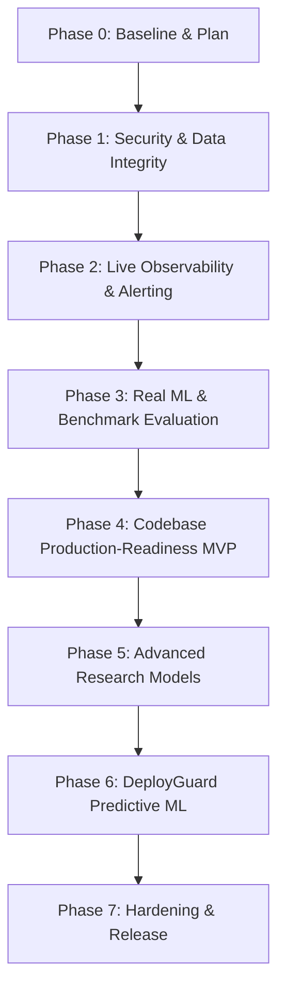

# AIOps Sentinel — Master Implementation Plan

**Date:** November 17, 2026  
**Status:** In Progress — Phase 0 Complete  
**Target Platform:** AIOps Sentinel (Runtime Observability + Codebase Production-Readiness Assessment)  

---

## 1. Baseline Findings & Verification Against Code

### 1.1 Findings Confirmed in Code
1. **Unenforced RBAC on Mutation Routes:** `get_current_admin` is defined in `backend/app/api/deps.py:40`, but is not imported or enforced across `backend/app/api/v1/alert-rules.py`, `settings.py`, and `deployments.py`. Any authenticated user with role `analyst` can perform privileged operations.
2. **Insecure Session Secret Fallback:** `backend/app/core/config.py:31` uses a default string `"replace-with-a-long-random-local-secret-32-chars-minimum"`. In production, this must fail startup.
3. **Mocked Experiment Training Metrics:** `backend/app/services/experiment_service.py:103-126` injects static evaluation dictionaries (`top_1_accuracy: 0.785` or `0.612`) and dummy artifact paths without executing real training/evaluation.
4. **Missing Local Benchmark Data:** `ml/data/` and `ml/artifacts/` are empty directories on disk.
5. **Missing Alert Evaluation Daemon:** Alert rules support CRUD in `backend/app/services/alert_service.py`, but there is no continuous background loop evaluating telemetry against rules.
6. **N+1 SQL Queries:** 
   - `ServicesService.list_services()`: sequential incident count queries in a loop (`backend/app/services/services_service.py:50-58`).
   - `DeploymentService.list_deployments()`: sequential incident count queries in a loop (`backend/app/services/deployment_service.py:40-47`).
7. **Telemetry Simulation Fallback:** `TelemetryClient` in `backend/app/integrations/telemetry.py` falls back to synthetic sine wave telemetry whenever Prometheus, Loki, or Tempo are unreachable, without explicit degraded UI indicators in live mode.
8. **Missing Alembic Configuration:** `Makefile` contains `alembic upgrade head`, but no `alembic.ini` or migration script directory exists.
9. **Missing Playwright Setup:** `Makefile` contains `npx playwright test`, but `@playwright/test` is not installed in `frontend/package.json`.

### 1.2 Findings That No Longer Apply / Are Already Resolved
- **Deployment Pre-Flight Check:** The pre-deployment verification window and blast radius risk analyzer have been implemented in `backend/app/services/deployment_service.py` and `frontend/src/app/(app)/deployments/page.tsx` with 5 automated gates and actionable remediation outputs.
- **Frontend Route Integrity:** All 15 existing routes (`/login`, `/overview`, `/services`, `/services/[id]`, `/incidents`, `/incidents/[id]`, `/topology`, `/deployments`, `/experiments`, `/experiments/[id]`, `/datasets`, `/alert-rules`, `/settings`, `/profile`, `/_not-found`) compile cleanly and return HTTP 200.

---

## 2. Implementation Order and Dependency Architecture

---

## 3. Phase Breakdown & Acceptance Gates

### Phase 1: Security & Data Integrity
- **Objectives:**
  1. Enforce production secret validation in `backend/app/core/config.py` (fail startup if default or <32 chars in staging/production).
  2. Implement strict RBAC: Role hierarchy (`viewer`, `analyst`, `operator`, `admin`), server-side dependencies (`require_role`, `get_current_admin`), and audit route enforcement.
  3. Token lifecycle hardening (configurable expiry, login rate limiting with IP/account backoff).
  4. Fix N+1 queries in `ServicesService.list_services()` and `DeploymentService.list_deployments()` using SQL `GROUP BY` aggregates.
  5. Initialize official Alembic async migrations supporting SQLite and PostgreSQL.
- **Acceptance Gate:**
  - Unauthorized mutation attempts return 403 Forbidden.
  - Startup in `APP_ENV=production` fails with default secret.
  - Database queries execute in $O(1)$ round trips.
  - `alembic check` and `alembic upgrade head` pass cleanly.
  - 100% of existing unit and integration tests pass.

### Phase 2: Live Observability & Durable Alert Evaluator
- **Objectives:**
  1. Add an instrumented multi-service sample workload in `compose.yaml` emitting OTLP metrics, logs, and traces.
  2. Complete `TelemetryClient` query paths for Prometheus, Loki, and Tempo.
  3. Eliminate silent simulation fallback in Live mode: return explicit source state (`connected`, `degraded`, `demo`).
  4. Build durable `AlertEvaluatorWorker` service evaluating enabled rules at configured intervals with state transitions, cooldowns, and deduplication.
- **Acceptance Gate:**
  - Induced fault in sample workload produces real retrievable telemetry and fires an alert.
  - Unavailable telemetry backends display "degraded" rather than fabricated data.
  - Alert worker unit and concurrency tests pass.

### Phase 3: Real ML Experiments & Benchmark Evaluation
- **Objectives:**
  1. Implement automated benchmark acquisition script (`scripts/download-benchmarks.py`) with Zenodo/GitHub verification and case-level split manifests.
  2. Replace mocked experiment creation in `backend/app/services/experiment_service.py` with real model execution over dataset splits.
  3. Persist genuine model artifacts (`.tar.gz` with fitted states, feature schemas, checksums) atomically into `ml/artifacts/`.
  4. Implement empirical confidence calibration (isotonic regression / Platt scaling).
- **Acceptance Gate:**
  - `POST /api/v1/experiments` trains/evaluates detectors on real split data.
  - Metrics are reproducible from random seed and dataset version.
  - Zero hardcoded mock metrics remain.

### Phase 4: Codebase Production-Readiness Assessment MVP
- **Objectives:**
  1. Safe multi-modal repository upload: ZIP archive, directory picker, and multi-file selection.
  2. Strict archive security: Zip-bomb defense, Zip-slip defense (`../` path traversal), symlink rejection, random workspace isolation (`/tmp/aiops_assessments/<uuid>`), secret redaction.
  3. Static Assessment Framework: 10 evaluation dimensions (Security, Reliability, Testing, Build/Deploy, Configuration, Observability, Code Quality, Supply Chain, Architecture, Documentation) for Python and JS/TS.
  4. Scoring & Explainable Verdict Engine: Deterministic versioned rubric (`v1.0.0`), stable rule IDs, file/line evidence links, and actionable remediation steps.
  5. Database models (`CodebaseAssessment`, `AssessmentFinding`, `AssessmentJob`) and async job execution.
  6. Frontend UI at `/codebase-assessments`, `/codebase-assessments/new`, `/codebase-assessments/[assessmentId]`.
- **Acceptance Gate:**
  - Uploading curated fixture repository produces evidence-backed report with correct file and line ranges.
  - Zip-slip, zip-bomb, and symlink payloads are cleanly rejected.
  - No uploaded code executes in static assessment mode.
  - Cross-user assessment access is strictly denied (403/404).

### Phase 5: Advanced Research Models
- **Objectives:**
  1. Multi-variate sliding-window temporal baseline.
  2. Graph Neural Network baseline (GraphSAGE / GAT over service dependency graph).
  3. Assumption-tested causal inference evaluation.
- **Acceptance Gate:**
  - Advanced models are benchmarked against statistical baselines on held-out test splits.
  - Negative results or trade-offs are documented transparently.

### Phase 6: DeployGuard Predictive Model & Safe Operations
- **Objectives:**
  1. Extract pre-deployment change features without future label leakage.
  2. Train and evaluate gradient-boosted / logistic regression change-risk predictor.
  3. Keep rule-based safety gate and ML prediction clearly distinguished in the UI.
  4. Human authorization and runbook execution safeguards.
- **Acceptance Gate:**
  - Predictor achieves PR-AUC/ROC-AUC superiority over random baseline on historical changes.
  - Deployment delivery remains human-approved and audited.

### Phase 7: Production Hardening & Release
- **Objectives:**
  1. Install and configure Playwright E2E test suite covering primary user journeys.
  2. Performance and concurrency benchmarks with documented latency results.
  3. Complete documentation suite (`README.md`, `docs/architecture.md`, `docs/security.md`, `docs/telemetry.md`, `docs/ml-research.md`, `docs/codebase-assessment.md`, `docs/api.md`).
- **Acceptance Gate:**
  - All E2E, integration, and unit tests pass.
  - Zero open critical security vulnerabilities.
  - Documentation accurately reflects reality.

---

## 4. Planned File Modifications & Additions

### Backend & Core
- `backend/app/core/config.py`: Production secret validation, environment mode checks.
- `backend/app/core/security.py`: Token lifecycle, rate limiting helpers.
- `backend/app/api/deps.py`: Role-based access control dependencies (`require_roles`, `get_current_admin`).
- `backend/app/api/v1/`: Enforce RBAC across `alert-rules.py`, `settings.py`, `deployments.py`, `datasets.py`, `incidents.py`.
- `backend/app/services/services_service.py`: Fix N+1 query via `GROUP BY`.
- `backend/app/services/deployment_service.py`: Fix N+1 query via `GROUP BY`.
- `backend/app/services/alert_worker.py`: New background alert evaluation service.
- `backend/app/services/experiment_service.py`: Wire real execution and artifact generation.
- `backend/alembic.ini`, `backend/alembic/`: Alembic database migration environment.

### Codebase Readiness Assessment Engine
- `backend/app/models/entities.py`: `CodebaseAssessment`, `AssessmentFinding`, `AssessmentJob`.
- `backend/app/schemas/domain.py`: Assessment request/response schemas.
- `backend/app/services/assessment/`:
  - `workspace.py`: Safe archive extraction, zip-slip defense, path normalization, cleanup.
  - `detector.py`: Project type & language discovery.
  - `analyzer.py`: Rule-based 10-dimension evaluation engine.
  - `secrets.py`: Hardcoded secret scanner with regex pattern matching and redaction.
- `backend/app/api/v1/assessments.py`: Assessment endpoints.
- `frontend/src/app/(app)/codebase-assessments/`: History, New Upload, and Detail Report views.

---

*Phase 0 baseline established. Proceeding directly to Phase 1 implementation.*
