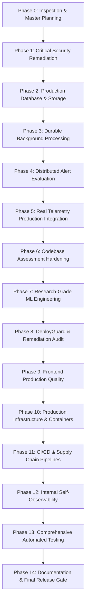

# AIOps Sentinel — Productionization Master Implementation Plan

**Date**: November 21, 2026  
**Author**: Principal Software Architect, Staff Full-Stack Engineer, AI/ML Systems Engineer, Application Security Engineer, SRE, DevOps Lead  
**Document Status**: APPROVED FOR IMPLEMENTATION  
**Repository**: [AIOps Sentinel](file:///Users/ashisranjanpradhan/Documents/AIops_sentinel)  

---

## 1. Executive Mission & Strategic Goals

The objective of this mandate is to transform AIOps Sentinel from an integration-tested prototype into a **genuinely production-deployable software product**. 

The system unifies two interconnected product capabilities:
1. **Runtime Software Reliability Intelligence (Pillar A)**: Real-time telemetry ingestion (Prometheus, Loki, Tempo, OTel), multi-variate statistical anomaly detection, microservice topology mapping, heuristic causal localization, DeployGuard release risk analysis, alert evaluation, and human-supervised incident remediation.
2. **Codebase Production-Readiness Assessment (Pillar B)**: Multi-modal ingestion (ZIP, directory, file list), 8 architectural profiles, multi-language structural analysis, 10-dimension production readiness scoring, secure HTML report exports, and OASIS SARIF v2.1.0 output.

---

## 2. Core Non-Negotiable Engineering Principles

1. **No Fabricated Functionality**: No hardcoded success payloads, fake ML metrics, or mocked live data.
2. **Truthful Production Mode**: In production (`APP_ENV=production`), synthetic fallback is strictly disabled. If telemetry is unreachable, mark status as `unavailable`, log warnings, and preserve system integrity without fabricating live signals.
3. **Enterprise UI Preservation**: Maintain the clean, restrained, high-contrast, accessible enterprise design system. Zero decorative emojis, sparkles, or robot icons.
4. **Security by Default**: Zero remote code execution on untrusted user code; rigorous input sanitization; strict HTML escaping for report exports; strict tenant and user ownership authorization (IDOR protection); secure cookies with SameSite/HttpOnly flags; SSRF defense on telemetry connector configs.
5. **Durable Asynchronous Execution**: Decouple heavy assessment, experiment, and alert workloads from the FastAPI HTTP request cycle into durable background workers backed by Redis and PostgreSQL.
6. **Scientific & Empirical Rigor**: True algorithm categorization (Statistical vs Machine Learning vs Graph Heuristics vs Rules Engine); truthful benchmark lineage distinguishing synthetic datasets from official RCAEval corpora; fixed and validated Isolation Forest inference.

---

## 3. Phased Implementation Roadmap

---

## 4. Phase-by-Phase Technical Specifications

### Phase 1: Critical Security Remediation (Immediate Release Blocker)
- **1.1 Stored XSS in HTML Report**:
  - *Location*: `backend/app/services/assessment/evaluator.py` (`generate_html_report`).
  - *Action*: Wrap all interpolated values (`project_name`, `title`, `description`, `file_path`, `remediation_advice`, `dimension`, `summary`) with `html.escape()`. Embed strict Content Security Policy (`default-src 'none'; style-src 'unsafe-inline'; font-src data:; img-src data:;`).
- **1.2 Assessment Ownership & IDOR Protection**:
  - *Location*: `backend/app/api/v1/assessments.py`, `backend/app/services/assessment/assessment_service.py`.
  - *Action*: Enforce `created_by_user_id == current_user.id` or `current_user.role in ('admin', 'operator')` across all routes:
    - `GET /assessments` (list filtered by user)
    - `GET /assessments/{id}`
    - `GET /assessments/{id}/export`
    - `GET /assessments/{id}/findings`
    - `GET /assessments/jobs/{job_id}`
    - `DELETE /assessments/{id}`
- **1.3 Secure Authentication & Password Hardening**:
  - *Location*: `backend/app/core/security.py`, `backend/app/services/auth_service.py`, `backend/app/api/v1/auth.py`.
  - *Action*: Validate password policy on `POST /auth/password`, enforce account lockout on repeated failed attempts, support refresh tokens and rotation (`/auth/refresh`), and log authentication audit events.
- **1.4 Secrets & Production Configuration Validation**:
  - *Location*: `backend/app/core/config.py`.
  - *Action*: In `staging` and `production`, fail fast if:
    - `SESSION_SECRET` is insecure or default.
    - `DATABASE_URL` is SQLite (PostgreSQL mandatory in production).
    - `DEMO_MODE` is True when `APP_ENV=production`.

### Phase 2: Production Database & Persistent Storage
- **2.1 PostgreSQL Engine & Connection Pooling**:
  - *Location*: `backend/app/db/session.py`.
  - *Action*: Configure async engine with `pool_size=10, max_overflow=20, pool_pre_ping=True, pool_recycle=1800` when PostgreSQL is configured. Preserve SQLite compatibility for isolated unit tests.
- **2.2 Tenant Isolation**:
  - *Action*: Enforce ownership constraints in ORM models and query layers.
- **2.3 Persistent Artifact Storage Abstraction**:
  - *Location*: `backend/app/services/storage_service.py`.
  - *Action*: Abstract artifact storage (`StorageService` interface with `LocalStorageBackend` and `S3StorageBackend`) for reports, SARIF exports, and model weights with access control and retention policies.

### Phase 3: Durable Background Processing
- **3.1 Task Queue Architecture**:
  - *Location*: `backend/app/services/queue_service.py`.
  - *Action*: Decouple assessments, model experiments, and report generation from in-process `asyncio.create_task()`.
  - *Components*:
    - Persistent job tracking via database records (`status`, `progress_percent`, `current_stage`, `error_message`, `retries`).
    - Redis-backed queue (`RedisTaskQueue`) for distributed deployments, with automatic resilient in-memory/DB fallback for local development.
    - Worker heartbeat, exponential backoff retries, and job cancellation support.
    - Job state recovery across backend restarts.

### Phase 4: Distributed Alert Evaluation
- **4.1 Dedicated Worker Service**:
  - *Location*: `backend/app/services/alert_worker.py`, `scripts/run-alert-worker.py`.
  - *Action*:
    - Implement PostgreSQL session advisory locking (`SELECT pg_try_advisory_lock(...)`) for multi-container Kubernetes deployments.
    - Maintain single-host `fcntl.flock` as fallback for local single-process development.
    - Automatic leader election, lock renewal, graceful lock release on `SIGTERM`/`SIGINT`.
    - Idempotent incident generation with deduplication windows to prevent split-brain duplicates.

### Phase 5: Real Telemetry Production Integration
- **5.1 Production Observability Hardening**:
  - *Location*: `backend/app/integrations/telemetry.py`.
  - *Action*:
    - Enforce SSRF protection: block private/loopback IP resolution on user-configured endpoints in production unless allowlisted.
    - Strict production truthfulness: if Prometheus, Loki, or Tempo are unreachable in `APP_ENV=production`, set status to `unavailable`, log alerts, and return empty data (no synthetic generation).
    - Correlate distributed traces with Loki logs and Prometheus metrics using `trace_id`.

### Phase 6: Codebase Production-Readiness Assessment Hardening
- **6.1 Analysis & Export Enhancements**:
  - Support relative directory trees across all upload modalities.
  - OASIS SARIF v2.1.0 schema compliance validation.
  - Fully escaped, styled standalone HTML export with security headers.
  - Clarified non-executing static analysis versus isolated execution sandbox preview.

### Phase 7: Research-Grade ML Engineering
- **7.1 Isolation Forest Window Sizing & Inference Fix**:
  - *Location*: `ml/src/aiops_ml/detectors/isolation_forest.py`, `backend/app/services/experiment_service.py`.
  - *Action*:
    - Adjust `min_samples` and decouple fitting requirements from online inference scoring.
    - Expand sliding evaluation windows ($\ge 20$) and extract multi-point statistical features.
    - Demonstrate non-zero detection performance ($F_1 > 0$, Recall $> 0$) on evaluation datasets.
- **7.2 Truthful Lineage & Model Categorization**:
  - Update all documentation and API metadata:
    - Robust Z-Score: Statistical detector.
    - EWMA: Statistical detector.
    - Isolation Forest: Unsupervised ML detector.
    - Causal Ranker: Graph & temporal onset heuristic.
    - DeployGuard: Rules-based release risk calculator.
  - Distinguish internal synthetic benchmark (60 episodes) from official external RCAEval (735 cases).

### Phase 8: DeployGuard & Remediation
- **8.1 Rules-Based Release Safety & Runbook Execution**:
  - Blast radius calculation, dependency risk weighting, and deployment safety gates.
  - Human-in-the-loop approval gates for remediation runbooks.
  - Strict allowlist for automated remediations (e.g. restart pod, rollback deployment, scale replicas). Zero arbitrary shell execution. Full operational audit trail.

### Phase 9: Frontend Production Quality
- **9.1 UX, Error Handling & Access Control**:
  - Maintain enterprise design system.
  - Ensure all routes handle loading, empty, and unauthorized states cleanly.
  - Secure token storage, session expiration handling, and seamless API error toasts.

### Phase 10: Production Infrastructure & Containers
- **10.1 Containerization & Orchestration**:
  - Multi-stage Dockerfiles (`backend/Dockerfile`, `frontend/Dockerfile`) running as non-root user `appuser`.
  - Production `docker-compose.prod.yml` provisioning:
    - Next.js frontend
    - FastAPI backend
    - Dedicated background worker
    - PostgreSQL 16
    - Redis 7
    - Caddy / Nginx reverse proxy with HTTPS and secure headers
- **10.2 Backup & Disaster Recovery**:
  - Create `scripts/backup-db.sh` and `scripts/restore-db.sh`.
  - Validate database backup and restoration on PostgreSQL.

### Phase 11: CI/CD & Software Supply Chain
- **11.1 Automated Pipeline**:
  - Comprehensive GitHub Actions workflow (`.github/workflows/ci.yml`) covering linting, backend pytest, frontend vitest, Playwright E2E, Docker builds, and security scans.

### Phase 12: Internal Self-Observability
- **12.1 Service Telemetry & Metrics**:
  - Prometheus `/api/v1/metrics` endpoint exposing HTTP latencies, DB connection pool health, queue depths, assessment throughput, and error rates.

### Phase 13: Comprehensive Testing & Verification
- **13.1 Validation Matrix**:
  - Security tests (XSS, IDOR, password policy, rate limiting).
  - Background queue & worker recovery tests.
  - ML inference correctness tests.
  - Full end-to-end user workflow tests.

### Phase 14: Documentation & Final Release Gate
- Complete all 11 required deliverables and create `PRODUCTION_READINESS_REPORT.md`.

---
*AIOps Sentinel Production Engineering Team*
