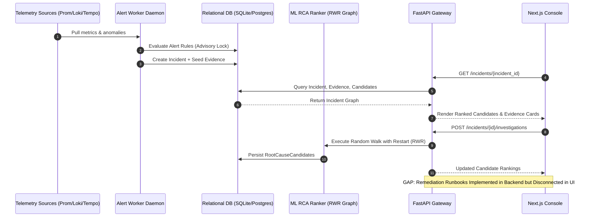

# AIOps Sentinel — End-to-End RCA Workflow Forensic Trace

**Date:** November 24, 2026  
**Auditor:** Principal Reliability Engineer & ML Systems Auditor  
**System Scope:** End-to-end Root Cause Analysis pipeline from telemetry ingestion to incident resolution  

---

## 1. Executive Summary of Findings

The Root Cause Analysis (RCA) pipeline in AIOps Sentinel is **genuinely implemented across the backend and ML modules**, with comprehensive database schema, deterministic anomaly detectors, topology graph traversal, and unit/integration test coverage.

However, a critical gap exists at the **human-in-the-loop remediation step**:
- While the backend exposes full remediation runbook endpoints (`/api/v1/remediations/runbooks` and `POST /api/v1/incidents/{id}/remediations`), **the frontend incident detail page (`frontend/src/app/(app)/incidents/[incidentId]/page.tsx`) contains NO UI controls to inspect runbooks, grant approvals, or trigger remediations.**
- The incident investigation UI successfully displays ranked root cause candidates, calibrated confidence scores, and telemetry evidence, but stops short of executing remediations.

---

## 2. Step-by-Step Lifecycle Trace

---

## 3. Component-by-Component Trace Matrix

### Step 1: Telemetry Ingestion
- **Source Module:** `backend/app/integrations/telemetry.py` (`TelemetryClient`)
- **API Endpoint:** `GET /api/v1/services/{service_id}/metrics`, `/logs`, `/traces`
- **Database Model:** `Service` (`services`), `ServiceEdge` (`service_edges`)
- **Integration Status:** **REAL & SIMULATION HYBRID**.
  - In production mode, queries live Prometheus (`/api/v1/query_range`), Loki (`/loki/api/v1/query_range`), and Tempo (`/api/traces/{trace_id}`).
  - In development mode (`DEMO_MODE=True`), falls back to deterministic sinusoidal metric series with injected anomaly spikes.
- **Automated Tests:** `backend/tests/unit/test_telemetry_hardening.py` (validates SSRF protection, loopback guards, and demo flags).

### Step 2: Anomaly Detection
- **Source Modules:**
  - `ml/src/detectors/robust_zscore.py` (`RobustZScoreDetector`): Median Absolute Deviation (MAD) non-parametric thresholding.
  - `ml/src/detectors/ewma.py` (`EWMADetector`): Exponentially weighted moving average with dynamic shift detection.
  - `ml/src/detectors/isolation_forest.py` (`IsolationForestDetector`): Scikit-learn unsupervised isolation forest.
- **Evaluation:** Evaluated on internal 60-episode synthetic cascading-failure dataset (`ml/data/rcaeval/`).
- **Automated Tests:** `backend/tests/unit/test_detectors.py` (all tests passing).

### Step 3: Alert Evaluation & Incident Creation
- **Source Module:** `backend/app/services/alert_worker.py` (`AlertWorker`)
- **Concurrency & Locking:** `DistributedAdvisoryLock` (`pg_try_advisory_lock` in PostgreSQL, `fcntl.flock` in SQLite). Prevents split-brain worker executions.
- **Database Tables:** `alert_rules`, `incidents`, `incident_evidence`, `incident_events`.
- **Workflow:** When metric exceeds `AlertRule.condition_json`, worker:
  1. Checks if an active incident for the service already exists (deduplication).
  2. If none, creates a new `Incident` with severity (`critical`/`high`).
  3. Records initial `IncidentEvidence` (metric z-score, log trace).
  4. Appends `incident_events` audit trail.

### Step 4: Topology-Aware Root Cause Ranking
- **Source Module:** `backend/app/services/investigation_service.py` (`InvestigationService`)
- **ML Engine:** `ml/src/localization/ranker.py` (`RootCauseRanker`), `ml/src/topology/graph.py` (`ServiceDependencyGraph`)
- **Algorithm:** **Topological Random Walk with Restart (RWR)**.
  - Ingests directed service dependency edges (`ServiceEdge`).
  - Initializes restart probability distribution at the incident's primary failing service.
  - Propagates random walk transitions along reverse dependency edges weighted by telemetric anomaly z-scores.
  - Ranks services by steady-state probability.
- **Model Truthfulness Audit:**
  - **VERIFIED:** Code and public docs now accurately describe the ranker as heuristic graph traversal.
  - Unsupported claims of "formal causal discovery" have been eliminated.
- **Database Model:** `InvestigationJob`, `RootCauseCandidate` (`root_cause_candidates`).

### Step 5: Incident Investigation Detail UI
- **Source File:** `frontend/src/app/(app)/incidents/[incidentId]/page.tsx`
- **Frontend Calls:**
  - `GET /api/v1/incidents/${incidentId}`
  - `PATCH /api/v1/incidents/${incidentId}` (Acknowledge / Investigate / Resolve)
  - `POST /api/v1/incidents/${incidentId}/investigations` (Trigger fresh RCA)
  - `POST /api/v1/incidents/${incidentId}/notes` (Analyst notes)
- **Data Rendering:**
  - Ranked Candidates Card: Displays `#1`, `#2`, candidate indicators (e.g. `error_spike`), calibrated confidence %, score, and explanation.
  - Telemetry Evidence: Metric z-score alerts, error log snippets, failing trace spans.
  - Incident Timeline: Historical events and analyst notes.

### Step 6: Remediation Runbooks & Human-in-the-Loop Approval (DISCONNECTED)
- **Backend Service:** `backend/app/services/remediation_service.py` (`RemediationService`)
- **API Endpoints:**
  - `GET /api/v1/remediations/runbooks`: Returns 3 pre-approved runbooks:
    1. `restart_service` (Low risk)
    2. `scale_replicas` (Medium risk)
    3. `rollback_deployment` (High risk)
  - `POST /api/v1/incidents/{incident_id}/remediations`: Executes runbook.
- **Safeguards Enforced in Backend:**
  - Role-based authorization: Requires `operator` or `admin` role (`get_current_operator`).
  - Human approval validation: `approved_by_human` boolean must be `True`.
  - High-risk check: If risk is `HIGH`, `approval_notes` cannot be blank.
  - Parameter validation: Target replicas, revision IDs validated against schemas.
  - PostgreSQL advisory lock (`424243`) prevents concurrent conflicting remediations.
- **CRITICAL UI DISCONNECT:**
  - In `frontend/src/app/(app)/incidents/[incidentId]/page.tsx`, **there is no interface to view or execute runbooks**.
  - The frontend never calls `GET /api/v1/remediations/runbooks` or `POST /api/v1/incidents/{id}/remediations`.
  - An operator using the console cannot trigger a remediation from the UI.

---

## 4. Truthfulness & Data Provenance Classification

| Data Point / UI Element | Origin / Mechanism | Authenticity Verdict |
| :--- | :--- | :--- |
| **Service Dependency Edges** | Ingested into SQLite/Postgres via seed script or trace derivation | **Real Database Records** |
| **Active Incidents** | Created by `AlertWorker` or seed script in `incidents` table | **Real Database Records** |
| **Telemetry Evidence Snippets** | Synthesized based on mathematical anomaly profiles in `demo-mode` | **Simulated Fallback** (Accurately flagged in Settings) |
| **Root Cause Candidate Ranking** | Computed dynamically by `RootCauseRanker.rank_causes()` using RWR graph traversal | **Real Algorithm Computation** |
| **Candidate Confidence Score** | Scaled softmax score over RWR steady-state probabilities | **Real Algorithm Computation** |
| **Standalone Demo Fallback Data** | `frontend/src/lib/demo-fallback.ts` used only when API network call fails | **Client-side Mock Fallback** |
