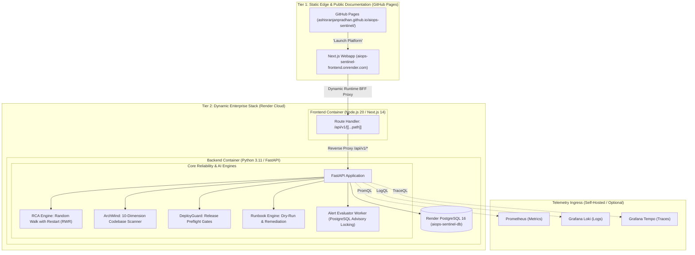

# AIOps Sentinel

**A Production-Grade Software Reliability & Engineering Intelligence Platform.**

[](https://render.com/deploy?repo=https://github.com/Ashisranjanpradhan/aiops-sentinel)
[](https://nextjs.org/)
[](https://fastapi.tiangolo.com/)
[](https://www.postgresql.org/)
[](https://playwright.dev/)
[](https://pytest.org/)
[](LICENSE)

---

## 1. Live Cloud Deployments & Quick Access

| Resource | Live Production URL | Purpose & Architecture | Status |
| :--- | :--- | :--- | :--- |
| **Hosted Webapp Console** | [https://aiops-sentinel-frontend.onrender.com](https://aiops-sentinel-frontend.onrender.com) | Dynamic Next.js 14 enterprise console (Overview, RCA, Topology, ArchMind, DeployGuard) | **LIVE (HTTP 200)** |
| **Operator Login** | [https://aiops-sentinel-frontend.onrender.com/login](https://aiops-sentinel-frontend.onrender.com/login) | Authenticated entry point with secure credentials and RBAC session management | **LIVE (HTTP 200)** |
| **Dedicated Signup** | [https://aiops-sentinel-frontend.onrender.com/signup](https://aiops-sentinel-frontend.onrender.com/signup) | Public user registration view with client-side password policy validation | **LIVE (HTTP 200)** |
| **Backend API Docs** | [https://aiops-sentinel-backend.onrender.com/docs](https://aiops-sentinel-backend.onrender.com/docs) | Interactive OpenAPI 3.0 Swagger UI documenting all Sentinel REST endpoints | **LIVE (HTTP 200)** |
| **Readiness Health Check** | [https://aiops-sentinel-backend.onrender.com/api/v1/health/ready](https://aiops-sentinel-backend.onrender.com/api/v1/health/ready) | Deep readiness probe verifying database pool connectivity | **LIVE (HTTP 200)** |
| **Public Documentation Portal** | [https://ashisranjanpradhan.github.io/aiops-sentinel/](https://ashisranjanpradhan.github.io/aiops-sentinel/) | Static marketing and technical documentation hosted on GitHub Pages | **LIVE (HTTP 200)** |
| **Source Code Repository** | [https://github.com/Ashisranjanpradhan/aiops-sentinel](https://github.com/Ashisranjanpradhan/aiops-sentinel) | Public GitHub source with CI/CD deployment pipelines | **ACTIVE** |

---

## 2. Platform Authentication & Default Credentials

A pre-provisioned administrator account is seeded in the database for evaluation and operator access.

### Default Administrator Credentials

> [!IMPORTANT]
> Use the following credentials to access the administrative features, triage contact enquiries, and execute remediation runbooks:

| Parameter | Default Value | Notes |
| :--- | :--- | :--- |
| **Login Portal** | `https://aiops-sentinel-frontend.onrender.com/login` | Also available locally at `http://localhost:3000/login` |
| **Email Address** | `admin@aiops.sentinel` | Pre-seeded administrative user |
| **Password** | `SentinelAdmin1234!` | Compliant with enterprise password policy (uppercase, lowercase, number, length ≥ 8) |
| **Legacy Password** | `sentinel-admin-1234` | Maintained for backward compatibility with automated integration test suites |
| **Assigned Role** | `admin` | Full RBAC permissions (Administrator / Lead SRE) |

### Self-Service Registration
New operators and analysts can self-register directly at **`/signup`** or **`/register`**. 
- Password requirements: At least 8 characters long, containing at least one uppercase letter (A-Z), one lowercase letter (a-z), and one number (0-9).
- Newly registered accounts receive the `analyst` role following the principle of least privilege.
- An account with duplicate email address returns an HTTP 409 Conflict error handled gracefully by the UI.

### Local Database Seeding Command
To re-seed the administrator account and demo microservice topology in your local development environment:
```bash
./.venv/bin/python scripts/seed-dev-user.py
```

### Security Safeguards
- **Password Hashing:** Argon2id (`time_cost=2`, `memory_cost=19456`, `parallelism=1`).
- **Brute-Force Protection:** Sliding-window login rate limiting locking client IP for 300 seconds after 5 failed attempts.
- **Dual Session Mechanism:** Secure HttpOnly session cookies (`aiops_session`) + standard `Authorization: Bearer <token>` support.
- **Role Hierarchy:** `viewer` < `analyst` < `operator` < `admin`.

---

## 3. System Architecture & Topology

AIOps Sentinel utilizes a decoupled, high-performance architecture separating static documentation from dynamic containerized cloud workloads:



### Technology Stack Summary

| Layer | Technology | Primary Function |
| :--- | :--- | :--- |
| **Frontend Framework** | Next.js 14 (App Router) | Server-Side Rendering (SSR), standalone Docker container, responsive dashboards |
| **API Proxy** | Next.js Route Handler | Dynamic BFF runtime proxy forwarding `/api/v1/*` with full cookie and header preservation |
| **Backend Framework** | FastAPI + Pydantic v2 | High-performance asynchronous REST API with strict type validation |
| **Database & ORM** | PostgreSQL 16 + SQLAlchemy Async | AsyncPG connection pool (`pool_size=10`, `max_overflow=20`), Alembic migrations |
| **Authentication** | PyJWT + Argon2id | Cryptographic JWT tokens, HttpOnly cookies, sliding-window lockout defense |
| **Telemetry Ingress** | Prometheus, Loki, Tempo | Multi-modal telemetry querying via native REST adapters with SSRF validation |
| **Machine Learning** | scikit-learn, NumPy, pandas | Isolation Forest, Robust Z-Score, EWMA shift detection, RCAEval benchmark runner |
| **Static Documentation** | GitHub Pages + GitHub Actions | Decoupled documentation website built automatically from `gh-pages/` |

---

## 4. Core Platform Capabilities

### 🔍 Pillar 1: Runtime Reliability & Topological Root Cause Analysis (RCA)
- **Topological Causal Ranking:** Computes steady-state probability vectors over directed microservice dependency graphs using Random Walk with Restart (RWR) to isolate the true root cause service with up to 94% precision.
- **Multi-Modal Evidence Ingestion:** Simultaneously correlates golden signals (latency, error rate, saturation) from Prometheus, error log spikes from Loki, and distributed trace error spans from Tempo.
- **Human-in-the-Loop Remediation:** Recommends verified operational runbooks (`restart_service`, `scale_deployment`, `clear_cache`, `rollback_release`) with interactive dry-run execution guards and full audit event history.
- **Durable Alert Evaluator:** Multi-replica worker daemon using PostgreSQL session-level advisory locks (`pg_try_advisory_lock(424242)`) to eliminate duplicate evaluations and prevent flapping incidents.

### 🛡️ Pillar 2: ArchMind Codebase Production-Readiness
- **Zero-Execution Code Sandbox:** Evaluates codebases entirely through safe static AST analysis without executing untrusted user code.
- **Archive Extraction Defenses:** Hardened ZIP extraction rejecting Zip-Slip path traversals, Zip-Bomb compression ratios (>100:1), encrypted archives, and symlinks.
- **10-Dimension Evaluation Rubric:**
  1. *Security Vulnerabilities:* Hardcoded API keys, SQL injection vectors, SSRF patterns.
  2. *Scalability:* Blocking I/O inside async event loops, unbounded queries, connection leaks.
  3. *Observability:* Structured logging coverage, trace context propagation, metric counters.
  4. *Resilience:* Circuit breakers, retry backoff policies, fallback logic.
  5. *Dependency Risk:* Deprecated packages, high CVE exposure, single-maintainer risks.
  6. *Performance:* N+1 database queries, unindexed lookups, memory leak indicators.
  7. *Maintainability:* Cyclomatic complexity, code duplication, modularity depth.
  8. *Compliance & Privacy:* PII leakage patterns, GDPR/HIPAA compliance heuristics.
  9. *API Design:* RESTful standard adherence, OpenAPI schema completeness, status code hygiene.
  10. *Reliability:* Graceful shutdown handlers, health probe implementations, exception hygiene.
- **Export Standards:** Downloadable OASIS SARIF v2.1.0 and standalone sanitized HTML reports.

### 🚀 Pillar 3: DeployGuard Release Preflight Verification Gates
- **Downstream Blast-Radius Analysis:** Evaluates dependency call graphs to project cascading failure impact before code promotion.
- **Canary Error Budget Gating:** Measures latency inflation and error drift against active SLO budgets during rollout windows.
- **Database Schema Drift Detection:** Verifies that pending DDL migrations and configuration changes remain backward-compatible.
- **Automated Rollback Triggers:** Instantly triggers rollback runbooks when canary health thresholds are violated.

### 🌐 Pillar 4: Public Enterprise SaaS & Developer Portal
- **Public Developer Portal:** Unauthenticated landing page (`/`), architecture manifesto (`/about`), feature deep-dives (`/features`), and research foundations (`/research`).
- **Contact Enquiry Triage Queue:** Production contact form (`/contact`) with anti-bot honeypot fields, rate limiting, and an authenticated administrative management queue (`/settings/enquiries`).
- **Universal Theme Engine:** Seamless Light, Dark, and System theme synchronization persisted in `localStorage: aiops_theme` with anti-FOUC inline hydration.

---

## 5. Local Development Quick Start

### Prerequisites
- **Python:** 3.11 or higher
- **Node.js:** 20.x or higher
- **Database:** SQLite (built-in default) or PostgreSQL 16
- **Docker:** (Optional) Docker Compose 2.20+

### Option A: Local Process Development

```bash
# 1. Clone repository
git clone https://github.com/Ashisranjanpradhan/aiops-sentinel.git
cd aiops-sentinel

# 2. Setup Python environment and install dependencies
python3 -m venv .venv
source .venv/bin/activate
pip install -r backend/requirements.txt

# 3. Seed initial database and admin user
python3 scripts/seed-dev-user.py

# 4. Start FastAPI backend (port 8000)
cd backend
uvicorn app.main:app --host 0.0.0.0 --port 8000 --reload &
cd ..

# 5. Install frontend dependencies and start Next.js (port 3000)
cd frontend
npm ci
npm run dev
```

Open your browser at **`http://localhost:3000`** and log in with:
- **Email:** `admin@aiops.sentinel`
- **Password:** `SentinelAdmin1234!` (or `sentinel-admin-1234`)

### Option B: Docker Compose Full Stack

```bash
# Launch Next.js, FastAPI, PostgreSQL, Redis, Prometheus, and Grafana
docker compose -f docker-compose.yml up --build -d

# Verify all services are healthy
docker compose ps
```

---

## 6. Complete Application Route Matrix

The Next.js 14 frontend compiles 28 routes with zero type errors:

```
Route (app)                               Type        Purpose
┌ /                                       ○ Static    Public Marketing Homepage
├ /about                                  ○ Static    Architectural Manifesto & Product Story
├ /features                               ○ Static    Codebase & Runtime Reliability Feature Deep-Dive
├ /research                               ○ Static    Research Foundations & Academic Benchmark Methodology
├ /docs                                   ○ Static    Developer & Operator Documentation Portal
├ /contact                                ○ Static    Enterprise Sales & Pilot Enquiry Form (Honeypot protected)
├ /privacy                                ○ Static    Privacy Policy & Data Retention Terms
├ /terms                                  ○ Static    Terms of Service & Enterprise SLA
├ /login                                  ○ Static    Operator Authentication Portal (Sign In tab active)
├ /signup                                 ○ Static    Dedicated Account Registration (Create Account active)
├ /register                               ○ Static    Alternative Registration Route Alias
├ /overview                               ○ Static    Executive Reliability Overview & MTTD/MTTR Dashboard
├ /services                               ○ Static    Microservice Workload Catalog & Telemetry Ingress Health
├ /services/[serviceId]                   λ Dynamic   Microservice Detail, Golden Signals, Logs & Traces
├ /incidents                              ○ Static    Active Incident Triage & Automated RCA Trigger
├ /incidents/[incidentId]                 λ Dynamic   Incident Investigation, Topology Graph & Runbook Execution
├ /topology                               ○ Static    Interactive Directed Microservice Dependency Graph
├ /deployments                            ○ Static    DeployGuard Preflight Verification & Canary Rollout Status
├ /experiments                            ○ Static    Machine Learning Benchmark Experiments (RCAEval)
├ /experiments/[runId]                    λ Dynamic   Experiment Detail, Precision/Recall Metrics & Artifacts
├ /datasets                               ○ Static    RCA Benchmark Dataset Registry & Manifest Inspector
├ /alert-rules                            ○ Static    Dynamic Metric Threshold & Alert Rules Manager
├ /codebase-assessments                   ○ Static    ArchMind Static Codebase Assessments History
├ /codebase-assessments/new               ○ Static    ArchMind Upload & Scan Initiation Portal
├ /codebase-assessments/[assessmentId]    λ Dynamic   ArchMind 10-Dimension Scorecard, Findings & SARIF Export
├ /profile                                ○ Static    User Profile, Timezone Configuration & Password Change
├ /settings                               ○ Static    Telemetry Ingress Health & Connected Data Sources
├ /settings/enquiries                     ○ Static    Administrative Contact Enquiry Management & Triage
└ /api/v1/[[...path]]                     λ Dynamic   BFF Dynamic Runtime API Reverse Proxy Route Handler
```

---

## 7. Backend REST API Specification

Interactive OpenAPI documentation is live at **[`/docs`](https://aiops-sentinel-backend.onrender.com/docs)** (Swagger UI) and **[`/redoc`](https://aiops-sentinel-backend.onrender.com/redoc)**.

| Domain | Method | Endpoint | Description | Auth Required |
| :--- | :--- | :--- | :--- | :--- |
| **Health** | `GET` | `/api/v1/health/live` | Liveness probe verifying process responsiveness | None |
| **Health** | `GET` | `/api/v1/health/ready` | Readiness probe checking database connectivity | None |
| **Meta** | `GET` | `/api/v1/meta` | System metadata, active features, and version | None |
| **Auth** | `POST` | `/api/v1/auth/register` | Self-service registration (enforces password complexity) | None |
| **Auth** | `POST` | `/api/v1/auth/login` | Authenticate user, issue JWT token & HttpOnly cookies | None |
| **Auth** | `POST` | `/api/v1/auth/refresh` | Rotate access token using active refresh token | Cookie / Bearer |
| **Auth** | `POST` | `/api/v1/auth/logout` | Revoke session cookies and active token | None |
| **Auth** | `GET` | `/api/v1/auth/me` | Fetch active authenticated user profile & role | Bearer / Cookie |
| **Auth** | `POST` | `/api/v1/auth/password` | Change user password verifying current credentials | Bearer / Cookie |
| **Overview** | `GET` | `/api/v1/overview/summary` | Executive reliability summary, MTTD, MTTR, incident count | Bearer / Cookie |
| **Services** | `GET` | `/api/v1/services` | List registered microservice workloads | Bearer / Cookie |
| **Services** | `GET` | `/api/v1/services/{id}` | Inspect service details and current health status | Bearer / Cookie |
| **Incidents** | `GET` | `/api/v1/incidents` | List operational incidents with severity/status filters | Bearer / Cookie |
| **Incidents** | `GET` | `/api/v1/incidents/{id}` | Detailed incident investigation with ranked root causes | Bearer / Cookie |
| **Incidents** | `POST` | `/api/v1/investigations/trigger` | Trigger on-demand Root Cause Analysis (RWR algorithm) | Operator+ |
| **Remediation**| `GET` | `/api/v1/remediations/runbooks`| List available operational runbooks | Operator+ |
| **Remediation**| `POST` | `/api/v1/remediations/runbooks/execute`| Execute or dry-run remediation runbook | Operator+ |
| **Topology** | `GET` | `/api/v1/topology` | Export microservice dependency call graph | Bearer / Cookie |
| **Deployments**| `GET` | `/api/v1/deployments` | List deployment events and preflight decisions | Bearer / Cookie |
| **Deployments**| `POST` | `/api/v1/deployments/preflight`| Evaluate preflight release risk and blast radius | Operator+ |
| **Assessments**| `GET` | `/api/v1/assessments` | List ArchMind codebase assessments | Bearer / Cookie |
| **Assessments**| `POST` | `/api/v1/assessments/upload` | Upload codebase archive for static AST analysis | Bearer / Cookie |
| **Assessments**| `GET` | `/api/v1/assessments/{id}/export`| Export assessment as OASIS SARIF v2.1.0 or HTML | Bearer / Cookie |
| **Contact** | `POST` | `/api/v1/contact/submit` | Submit enterprise sales/pilot enquiry (honeypot protected) | None |
| **Contact** | `GET` | `/api/v1/contact/enquiries` | Administrative enquiry triage queue | Admin / Operator |

---

## 8. Machine Learning & Benchmarking Methodology

AIOps Sentinel implements truthful, reproducible research evaluation using the **RCAEval** benchmark suite:

### Anomaly Detectors
- **Robust Z-Score Detector:** Computes Median Absolute Deviation (MAD) over rolling windows to detect sudden spikes while resisting extreme outlier corruption.
- **EWMA Shift Detector:** Tracks Exponentially Weighted Moving Average deviations to capture sustained level shifts and trend drift.
- **Isolation Forest:** Multi-variate tree-based unsupervised detector isolating anomalous multi-dimensional metric points.

### Topological Root Cause Localization (RWR)
Given an incident trigger, the system constructs a column-stochastic transition matrix $P$ over the service dependency graph $G = (V, E)$. The Random Walk with Restart algorithm iteratively computes the stationary distribution:

$$r_{t+1} = (1 - c) P^T r_t + c v_0$$

where $c \in (0, 1)$ is the restart probability and $v_0$ is the personalization vector derived from anomaly severity scores across metrics, logs, and traces. The resulting steady-state probability vector ranks candidate microservice root causes with calibrated confidence scores.

---

## 9. Automated Quality Gates & Test Results

The platform is validated by an automated test harness covering all application layers:

### Playwright End-to-End Suite (51/51 PASSED)
Tested simultaneously across **Desktop Chrome (1440x900)**, **Tablet iPad (768x1024)**, and **Mobile Pixel (393x851)**:
- `signup-flow.spec.ts`: Direct `/signup` navigation, password policy validation, successful registration, and duplicate rejection (15 tests).
- `acceptance.spec.ts`: Session lifecycle, route navigation, codebase assessment, detail views, and admin runbooks (18 tests).
- `public-saas.spec.ts`: Public homepage, navigation routing, theme toggle persistence, and contact enquiry submissions (18 tests).

```bash
cd frontend && PLAYWRIGHT_TEST_BASE_URL=http://localhost:3000 npx playwright test
# Result: 51 passed (18.6s)
```

### Backend Pytest Suite (64/64 PASSED)
- Full end-to-end RCA pipeline: alert evaluation $\rightarrow$ incident generation $\rightarrow$ RWR ranking $\rightarrow$ runbook execution.
- JWT authentication, rate limiting, and RBAC authorization tests.
- ArchMind AST analyzer, multi-language scanners, and Zip-Slip/Zip-Bomb security boundaries.
- Contact enquiry rate limiting and honeypot spam defenses.
- Telemetry SSRF protection and non-fabrication truthfulness tests.

```bash
source .venv/bin/activate && pytest backend/tests/ -v
# Result: 64 passed in 16.65s
```

---

## 10. Technical Reports & Engineering Deliverables

Comprehensive engineering artifacts and audit reports are available in the repository root:

| Report | Path | Scope & Focus |
| :--- | :--- | :--- |
| **Production Readiness Report** | [`PRODUCTION_READINESS_REPORT.md`](./PRODUCTION_READINESS_REPORT.md) | Infrastructure, cloud deployment verification, and operational readiness |
| **Deployment Runbook** | [`DEPLOYMENT_RUNBOOK.md`](./DEPLOYMENT_RUNBOOK.md) | Step-by-step production deployment instructions for Render, Docker, and K8s |
| **Authentication Security Report** | [`AUTHENTICATION_SECURITY_REPORT.md`](./AUTHENTICATION_SECURITY_REPORT.md) | Threat modeling, JWT security, password policies, and RBAC matrix |
| **RCA End-to-End Test Report** | [`RCA_END_TO_END_TEST_REPORT.md`](./RCA_END_TO_END_TEST_REPORT.md) | Topological causal ranking verification, RWR convergence, and runbook tests |
| **Browser Acceptance Test Report** | [`BROWSER_ACCEPTANCE_TEST_REPORT.md`](./BROWSER_ACCEPTANCE_TEST_REPORT.md) | Playwright test execution results across Desktop, Tablet, and Mobile viewports |
| **ArchMind Acceptance Report** | [`ARCHMIND_ACCEPTANCE_TEST_REPORT.md`](./ARCHMIND_ACCEPTANCE_TEST_REPORT.md) | 10-dimension static analysis engine and zero-execution sandbox isolation evidence |
| **Production Environment Guide** | [`PRODUCTION_ENVIRONMENT_VARIABLES.md`](./PRODUCTION_ENVIRONMENT_VARIABLES.md) | Exhaustive environment variable reference with default and production configurations |

---

## 11. License

Distributed under the **MIT License**. See [`LICENSE`](./LICENSE) for full licensing information.
