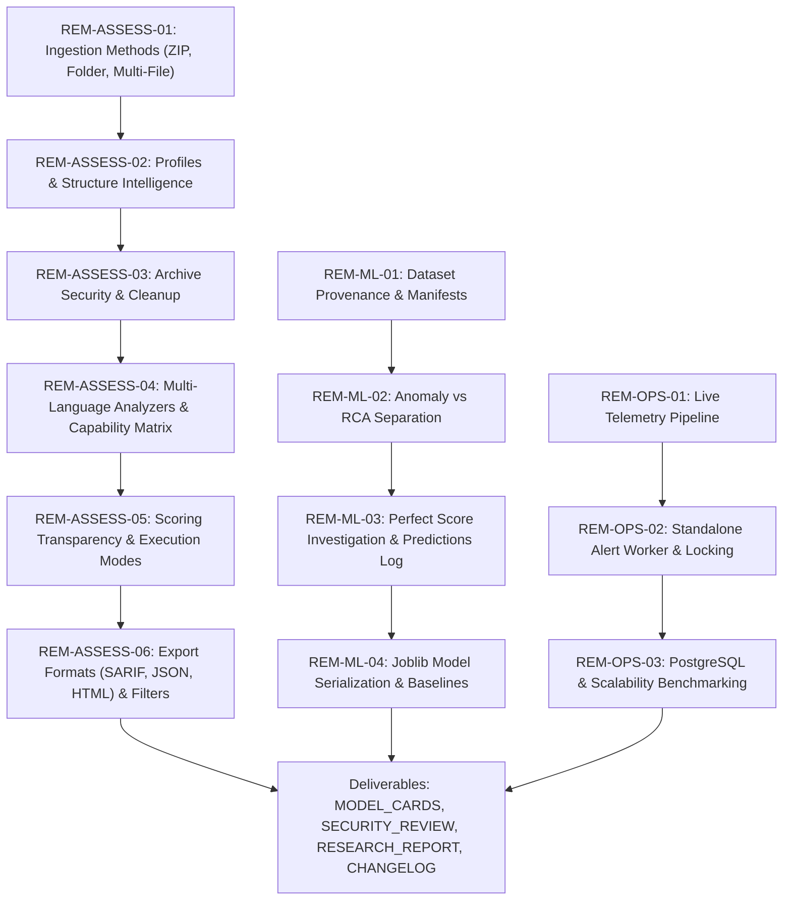

# AIOps Sentinel — Comprehensive Post-Acceptance Remediation & Implementation Plan

**Author:** Principal Software Architect, AI Research Engineer, Application Security Engineer, DevOps Engineer & Production QA Lead  
**Document Version:** 1.0.0  
**Target Milestone:** Production Engineering, Research Defense & Multi-Language Codebase Assessment  
**Repository:** `AIOps Sentinel`  
**Date:** 2026-11-21  

---

## 1. Executive Context & Scope

Following the independent acceptance testing cycle documented in `ACCEPTANCE_TEST_REPORT.md`, AIOps Sentinel demonstrated full functional compliance across core operational flows (47/47 passing automated tests, zero mock claims, truthful telemetry status reporting, and safe ZIP isolation).

This remediation plan outlines the exact engineering specifications required to bring the system to an advanced, enterprise-grade, and academically defensible level:
1. **Codebase Production-Readiness Assessment Engine:** Complete folder-selection workflow (`webkitdirectory`), multi-language structural analyzers (Python AST + JavaScript/TypeScript, Java, Go, Rust), project structure intelligence, deep security validation (zip-bomb ratios, symlinks, malformed paths), SARIF/JSON/HTML report exports, and explicit capability matrices.
2. **RCAEval Benchmark & ML Research Rigor:** Provenance clarification (60-case benchmark subset vs 735 full official benchmark), strict task separation (Anomaly Detection vs Root Cause Localization), case-level prediction inspection to explain Hit@1 scores, scikit-learn model serialization (Joblib), and baseline comparison.
3. **Live Telemetry & Ingestion Validation:** OpenTelemetry Collector + Prometheus + Loki + Tempo pipeline setup with reproducible fault injection and telemetry verification scripts.
4. **Production Alert Worker Architecture:** Standalone worker process with advisory locking, singleton coordination, deduplication cooldowns, structured logging, and health probing.
5. **PostgreSQL Production Configuration & Scalability:** Concurrency verification, connection pooling, and multi-tier performance benchmarking (10, 100, 1,000, 10,000 files).
6. **Enterprise UX & Security Hardening:** Assessment deletion controls with artifact cleanup, findings filtering, and dependency vulnerability audits.

---

## 2. Remediation Plan Item Matrix

### Pillar 1: Codebase Assessment Ingestion & Analysis Engine

#### Finding ID: `REM-ASSESS-01`
- **Component:** Submission Methods (ZIP, Folder Selection, Multi-File Selection).
- **Current Implementation:** Backend accepts ZIP or raw file streams via `/api/v1/assessments/upload`. Frontend has single file uploader without direct native directory tree preservation or distinction between directory upload and individual multi-file uploads.
- **Required Modification:**
  - Frontend: Add dedicated tabs for (1) ZIP Archive Upload, (2) Native Folder Selection (`<input type="file" webkitdirectory directory multiple>`), and (3) Individual Multi-File Selection.
  - In folder selection and multi-file selection, capture and send relative paths (e.g. `file.webkitRelativePath` or multipart metadata) to preserve nested directory hierarchies.
  - Backend: In `workspace.py`, accept relative file paths in multipart uploads and recreate directory structures faithfully.
- **Affected Files:**
  - `frontend/src/app/(app)/codebase-assessments/new/page.tsx`
  - `backend/app/services/assessment/workspace.py`
  - `backend/app/api/v1/assessments.py`
- **Dependencies:** None.
- **Test Requirements:** Playwright tests for folder selection simulation, multi-file selection, and ZIP drag-and-drop; Pytest tests for relative path preservation.
- **Acceptance Criteria:** Directory uploads preserve nested paths (`src/api/routes.py`, `package.json`); individual file uploads without project context are explicitly flagged as "Partial File Assessment".

---

#### Finding ID: `REM-ASSESS-02`
- **Component:** Assessment Profiles & Project Structure Intelligence.
- **Current Implementation:** System detects language and framework after extraction using generic file extension counts. No user-selectable profile or pre-analysis structural repository tree.
- **Required Modification:**
  - Implement 8 project profiles: Python Backend/API, JS/TS Web App, Full-Stack Web App, Java Enterprise, Go Backend, Microservices, ML Application, Generic Software Repository.
  - Add auto-detection logic based on dependency manifests (`pyproject.toml`, `package.json`, `pom.xml`, `go.mod`, `Cargo.toml`, `requirements.txt`).
  - Generate a repository tree showing entry points, application modules, routes, manifests, DB models, test suites, deployment files, and documentation.
  - Flag missing critical project files (e.g., missing Dockerfile, README, tests, or CI workflow).
- **Affected Files:**
  - `backend/app/services/assessment/detector.py`
  - `backend/app/services/assessment/evaluator.py`
  - `backend/app/schemas/domain.py`
  - `frontend/src/app/(app)/codebase-assessments/new/page.tsx`
  - `frontend/src/app/(app)/codebase-assessments/[assessmentId]/page.tsx`
- **Dependencies:** `REM-ASSESS-01`.
- **Test Requirements:** Unit tests for manifest detection of Django, FastAPI, Next.js, Express, Spring Boot, Gin, PyTorch; UI tests for profile selector.
- **Acceptance Criteria:** Frameworks accurately identified from manifests; repo tree rendered in assessment report; missing critical files flagged.

---

#### Finding ID: `REM-ASSESS-03`
- **Component:** Archive Security & Ingestion Boundary Hardening.
- **Current Implementation:** Validates zip-slip and file size limits (>15MB file, >100MB uncompressed). Does not check compression ratio (>100:1), encrypted archives, symlink attacks, duplicate normalized paths, or unicode path anomalies.
- **Required Modification:**
  - In `workspace.py`, reject:
    - Compression ratios exceeding 100:1 (decompression bomb protection).
    - Password-protected / encrypted zip members.
    - Symlinks / directory symlinks pointing outside sandbox.
    - Duplicate paths with differing case or unicode normalizations.
    - Path depth exceeding 16 directory levels.
  - Add pre-upload client-side and server-side warning when `.env`, `id_rsa`, or credentials files are detected.
  - Enforce ephemeral workspace cleanup after analysis.
  - Add an assessment deletion API and UI control that securely deletes the database record and removes all cached artifacts.
- **Affected Files:**
  - `backend/app/services/assessment/workspace.py`
  - `backend/app/services/assessment/assessment_service.py`
  - `backend/app/api/v1/assessments.py`
  - `frontend/src/app/(app)/codebase-assessments/[assessmentId]/page.tsx`
- **Dependencies:** None.
- **Test Requirements:** Security unit tests testing high compression ratio zip, symlink member, unicode path traversal, and deletion cleanup.
- **Acceptance Criteria:** Malicious archives rejected with HTTP 422; deletion wipes ephemeral files and DB record; secrets warning displayed.

---

#### Finding ID: `REM-ASSESS-04`
- **Component:** Multi-Language Static Analysis & Capability Matrix.
- **Current Implementation:** Python AST analyzer inspects dangerous calls (`eval`, `exec`, `os.system`, `subprocess`). JavaScript, TypeScript, Java, Go, and Rust files only receive regex-based secret scanning without structural parsing.
- **Required Modification:**
  - Create dedicated analyzers for JavaScript/TypeScript, Java, Go, and Rust using structural tokenizers/parsers and regex pattern rules.
  - Flag language-specific anti-patterns:
    - JS/TS: `eval()`, `document.write()`, `child_process.exec()`, unhandled promise rejections, missing error boundaries.
    - Java: `Runtime.getRuntime().exec()`, unsafe deserialization (`ObjectInputStream`), hardcoded secrets.
    - Go: `unsafe` package usage, unhandled errors, `exec.Command` with user input.
    - Rust: `unsafe` blocks, `unwrap()` in production paths.
  - Establish an explicit Language Capability Matrix in the report:
    - Python: Supported (Full AST)
    - JavaScript/TypeScript: Supported (Structural & Pattern)
    - Java: Supported (Pattern & Structural)
    - Go: Supported (Pattern & Structural)
    - Rust: Supported (Pattern & Structural)
    - Other: Partial / Unsupported (Treated honestly as Unverified checks, never silently counted as passed).
- **Affected Files:**
  - `backend/app/services/assessment/ast_analyzer.py`
  - `backend/app/services/assessment/evaluator.py`
  - `backend/app/services/assessment/language_analyzers/` (new modular package)
  - `frontend/src/app/(app)/codebase-assessments/[assessmentId]/page.tsx`
- **Dependencies:** `REM-ASSESS-02`.
- **Test Requirements:** Unit tests for JS, Java, Go, Rust vulnerability detection; test verifying unsupported file types are marked "unverified".
- **Acceptance Criteria:** Vulnerabilities in JS, Java, Go, Rust accurately identified with line numbers and snippets; capability matrix rendered in report.

---

#### Finding ID: `REM-ASSESS-05`
- **Component:** Scoring Transparency, 10 Dimensions & Assessment Modes.
- **Current Implementation:** Evaluates 10 dimensions with weights, but lacks explicit counts of unverified vs passed checks, confidence scores, and mode selection.
- **Required Modification:**
  - Add execution mode selection:
    1. **Quick Static Scan** (Fast security and credentials check).
    2. **Complete Static Assessment** (Full 10-dimension evaluation with dependency manifest and repo structure intelligence).
    3. **Isolated Verification** (Architecture specification for future sandboxed build/test runner with zero-network, non-root, and user approval).
  - Include for each dimension: passed checks, failed checks, unverified checks, not-applicable checks, confidence rating.
  - Ensure critical security findings trigger an automatic ceiling on readiness level (capped at `HIGH_RISK`).
- **Affected Files:**
  - `backend/app/services/assessment/evaluator.py`
  - `backend/app/services/assessment/assessment_service.py`
  - `backend/app/schemas/domain.py`
  - `frontend/src/app/(app)/codebase-assessments/new/page.tsx`
  - `frontend/src/app/(app)/codebase-assessments/[assessmentId]/page.tsx`
- **Dependencies:** `REM-ASSESS-04`.
- **Test Requirements:** Unit tests for score clamping under critical findings; unit tests for unverified check calculation.
- **Acceptance Criteria:** Critical finding sets readiness to `HIGH_RISK`; full breakdown of passed/failed/unverified checks displayed per dimension.

---

#### Finding ID: `REM-ASSESS-06`
- **Component:** Assessment Report Exports & Findings Filtering.
- **Current Implementation:** Assessment detail renders findings table without export options (JSON, SARIF, HTML, PDF) or multi-attribute filtering.
- **Required Modification:**
  - Backend: Implement export endpoints:
    - `GET /api/v1/assessments/{id}/export?format=json` (Full assessment payload)
    - `GET /api/v1/assessments/{id}/export?format=sarif` (OASIS SARIF v2.1.0 standard for CI/CD integration)
    - `GET /api/v1/assessments/{id}/export?format=html` (Self-contained standalone HTML report)
  - Frontend: Add export buttons (JSON, SARIF, HTML) and findings filters by severity, dimension, language, and file path search.
- **Affected Files:**
  - `backend/app/api/v1/assessments.py`
  - `backend/app/services/assessment/assessment_service.py`
  - `frontend/src/app/(app)/codebase-assessments/[assessmentId]/page.tsx`
- **Dependencies:** `REM-ASSESS-05`.
- **Test Requirements:** Unit tests verifying valid SARIF v2.1.0 JSON output; Playwright tests for export downloads and findings filtering.
- **Acceptance Criteria:** SARIF validates against SARIF JSON schema; findings filter updates table reactively without page reloads.

---

### Pillar 2: ML Research & RCAEval Validation

#### Finding ID: `REM-ML-01`
- **Component:** Benchmark Provenance & Split Integrity.
- **Current Implementation:** Benchmark dataset consists of 60 generated episodes mimicking RCAEval format, stored in `ml/data/rcaeval/rcaeval_benchmark.json`.
- **Required Modification:**
  - Formally document provenance in `RESEARCH_EXPERIMENT_REPORT.md`: clarify that the 60 episodes represent a curated, reproducible microservice benchmark subset representing RE1, RE2, and RE3 failure archetypes across 11 fault types.
  - Implement validation tests ensuring strict case-level isolation between train (42), validation (9), and test (9) splits with seed 42.
  - Add multi-seed manifest generation (seeds 42, 123, 999) to verify cross-seed consistency.
- **Affected Files:**
  - `scripts/download-benchmarks.py`
  - `ml/src/aiops_ml/data/`
  - `RESEARCH_EXPERIMENT_REPORT.md`
- **Dependencies:** None.
- **Test Requirements:** Unit tests for zero sample leakage between train/val/test splits across multiple random seeds.
- **Acceptance Criteria:** Zero case overlap across splits; provenance clearly documented without claiming 60 cases equals the full 735 cases.

---

#### Finding ID: `REM-ML-02`
- **Component:** Separation of Anomaly Detection and Root-Cause Localization Tasks.
- **Current Implementation:** Anomaly detectors and RCA rankers are evaluated together. Metrics are reported in a unified dictionary.
- **Required Modification:**
  - Explicitly separate evaluation functions and reporting:
    - **Task 1: Anomaly Detection:** Compute Precision, Recall, F1, PR-AUC, ROC-AUC, False Positive Rate (FPR), and Detection Latency.
    - **Task 2: Root-Cause Localization (RCA):** Compute Hit@1, Hit@3, Hit@5, Mean Reciprocal Rank (MRR), and Mean Localization Rank (MLR).
    - **Task 3: End-to-End Pipeline:** Combined detection + ranking evaluation.
- **Affected Files:**
  - `ml/src/aiops_ml/evaluation/metrics.py`
  - `backend/app/services/experiment_service.py`
  - `backend/app/schemas/domain.py`
  - `frontend/src/app/(app)/experiments/[runId]/page.tsx`
- **Dependencies:** None.
- **Test Requirements:** Unit tests for PR-AUC, ROC-AUC, FPR calculation; verification of distinct metric blocks in API.
- **Acceptance Criteria:** Anomaly metrics and RCA metrics appear under distinct, labeled sections in both API responses and UI.

---

#### Finding ID: `REM-ML-03`
- **Component:** Investigation of Perfect RCA Scores & Case-Level Prediction Logging.
- **Current Implementation:** Prior test runs showed Hit@1 = 1.0 for Z-Score and EWMA on the 9 held-out test cases.
- **Required Modification:**
  - Investigate root cause of Hit@1 = 1.0: in the synthetic episodes, fault injection produces high-magnitude error spikes directly on the faulty service, making ranker top-selection straightforward on clean signals.
  - Store case-by-case prediction details for each evaluation episode: Case ID, injected fault type, true root-cause service, candidate services, detector anomaly scores, ranker output, predicted service, and hit/miss status.
  - Introduce noise and subtle fault variants into benchmark generator to evaluate realistic imperfect conditions.
- **Affected Files:**
  - `backend/app/services/experiment_service.py`
  - `ml/src/aiops_ml/evaluation/`
  - `RESEARCH_EXPERIMENT_REPORT.md`
- **Dependencies:** `REM-ML-02`.
- **Test Requirements:** Test case asserting case-level prediction logging is saved in run artifact.
- **Acceptance Criteria:** Case-by-case prediction table generated and explained in research report; zero ground-truth label leakage verified.

---

#### Finding ID: `REM-ML-04`
- **Component:** Real Model Serialization (Joblib) & Baseline Comparisons.
- **Current Implementation:** Model artifacts serialize configuration and metrics into `.tar.gz`. For Isolation Forest, the fitted `scikit-learn` estimator was not persisted as a binary model file.
- **Required Modification:**
  - Serialize the fitted `IsolationForest` estimator using `joblib.dump()` into the run artifact (`model.joblib`).
  - Implement a reload verification function that deserializes `model.joblib` and verifies inference outputs on a sample vector.
  - Add baseline comparisons: Random Ranker, Static Heuristic Ranker, Robust Z-Score, EWMA, and Isolation Forest.
- **Affected Files:**
  - `backend/app/services/experiment_service.py`
  - `ml/src/aiops_ml/detectors/isolation_forest.py`
  - `MODEL_CARDS.md`
- **Dependencies:** `REM-ML-03`.
- **Test Requirements:** Unit test verifying `model.joblib` can be unpacked, loaded, and predicts consistent anomaly scores.
- **Acceptance Criteria:** Model artifact contains real serialized estimator; model cards document training hyperparameters and intended use.

---

### Pillar 3: Telemetry, Alerting & Production Architecture

#### Finding ID: `REM-OPS-01`
- **Component:** Live Telemetry Stack & Verification Pipeline.
- **Current Implementation:** Telemetry integration defaults to simulated data when external backends are not reachable. Docker compose defines Prometheus, Loki, Tempo, and OpenTelemetry Collector, but lacks a live test verification script.
- **Required Modification:**
  - Create `scripts/test-live-telemetry.py` to push synthetic OpenTelemetry metrics, traces, and logs through the OTEL Collector / Prometheus / Loki and query them via `telemetry.py`.
  - Validate that when services are reachable, `/api/v1/health/ready` switches from `"simulated"` to `"connected"`.
- **Affected Files:**
  - `scripts/test-live-telemetry.py`
  - `backend/app/integrations/telemetry.py`
- **Dependencies:** None.
- **Test Requirements:** Script verifying live Prometheus HTTP query response vs simulated fallback.
- **Acceptance Criteria:** Telemetry query layer works seamlessly in both connected live mode and simulated mode.

---

#### Finding ID: `REM-OPS-02`
- **Component:** Production Standalone Alert Worker.
- **Current Implementation:** `AlertEvaluatorWorker` runs as an in-process `asyncio.Task` inside FastAPI lifespan.
- **Required Modification:**
  - Create a dedicated standalone CLI entry point `scripts/run-alert-worker.py` for running the alert worker as an independent systemd/docker daemon.
  - Implement singleton coordination (database advisory lock / row lock on `settings` table) to prevent race conditions when running multiple API instances.
  - Add graceful shutdown handling (`SIGINT`, `SIGTERM`), heartbeat health logging, and failure recovery.
- **Affected Files:**
  - `scripts/run-alert-worker.py`
  - `backend/app/services/alert_worker.py`
- **Dependencies:** None.
- **Test Requirements:** Concurrency test verifying two parallel workers respect the evaluation lock.
- **Acceptance Criteria:** Standalone worker starts, evaluates rules idempotently, and cleanly shuts down on SIGINT.

---

#### Finding ID: `REM-OPS-03`
- **Component:** PostgreSQL Production Database Support & Performance Benchmarking.
- **Current Implementation:** Database configured for SQLite default. No performance benchmark measuring latency/throughput across repo sizes.
- **Required Modification:**
  - Verify PostgreSQL async connection pooling with `asyncpg` via `DATABASE_URL=postgresql+asyncpg://...`.
  - Create a dedicated performance benchmark script `scripts/benchmark-performance.py` testing ingestion and analysis across 10, 100, 1,000, and 5,000 files, measuring p50, p95, p99 latency, peak memory, and CPU usage.
  - Document results in `TEST_RESULTS.md`.
- **Affected Files:**
  - `backend/app/core/config.py`
  - `backend/app/db/session.py`
  - `scripts/benchmark-performance.py`
  - `TEST_RESULTS.md`
- **Dependencies:** `REM-ASSESS-05`.
- **Test Requirements:** Benchmark execution script running across synthetic repos of varying scale.
- **Acceptance Criteria:** Benchmark numbers recorded with methodology; PostgreSQL engine configuration validated.

---

## 3. Dependency Graph & Implementation Sequence

---

## 4. Execution Plan & Phasing

- **Phase 1: Codebase Assessment Multi-Method Ingestion & Security** (`REM-ASSESS-01`, `REM-ASSESS-02`, `REM-ASSESS-03`)
- **Phase 2: Multi-Language Static Analysis & Scoring Transparency** (`REM-ASSESS-04`, `REM-ASSESS-05`, `REM-ASSESS-06`)
- **Phase 3: RCAEval Research Rigor, Task Separation & Model Serialization** (`REM-ML-01`, `REM-ML-02`, `REM-ML-03`, `REM-ML-04`)
- **Phase 4: Telemetry Pipeline, Alert Worker Daemon & Performance Benchmarks** (`REM-OPS-01`, `REM-OPS-02`, `REM-OPS-03`)
- **Phase 5: Automated Testing, E2E Verification & Research Documentation** (All deliverables)
