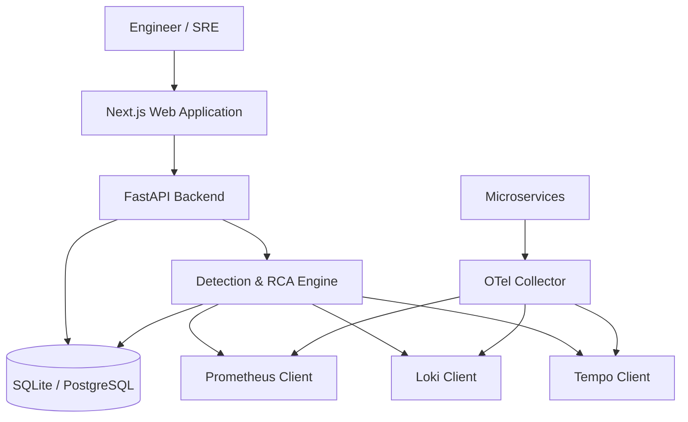

# System Architecture - AIOps Sentinel

## 1. Overview
AIOps Sentinel is an end-to-end observability and incident investigation platform designed for microservice systems. It correlates metrics, logs, distributed traces, and service topology to detect anomalous system states, rank candidate root causes, and provide observable evidence to SREs.

## 2. Component Boundaries
- **Frontend**: Next.js 14 (App Router) + TypeScript + Tailwind CSS. Provides 14 production-grade operational routes with accessible data views, status indicators, and zero decorative AI fluff.
- **Backend**: FastAPI modular application with async SQLAlchemy 2.0 ORM, Argon2id security, JWT session tokens, and standardized JSON response envelope.
- **ML & RCA Engine**:
  - `RobustZScoreDetector`: rolling median and median absolute deviation (MAD).
  - `EWMADetector`: streaming shift detection.
  - `IsolationForestDetector`: unsupervised multivariate anomaly detection.
  - `ServiceDependencyGraph`: NetworkX directed graph modeling microservice topology.
  - `RootCauseRanker`: multi-modal evidence correlation with topological distance weighting and confidence calibration.
- **Persistence**: PostgreSQL for production / SQLite with `aiosqlite` for zero-friction standalone development.
